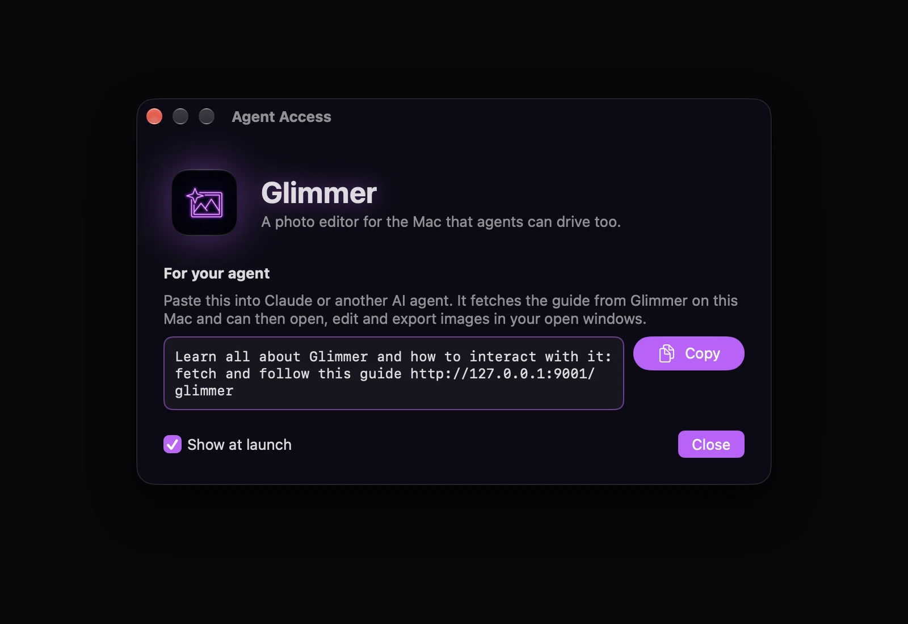
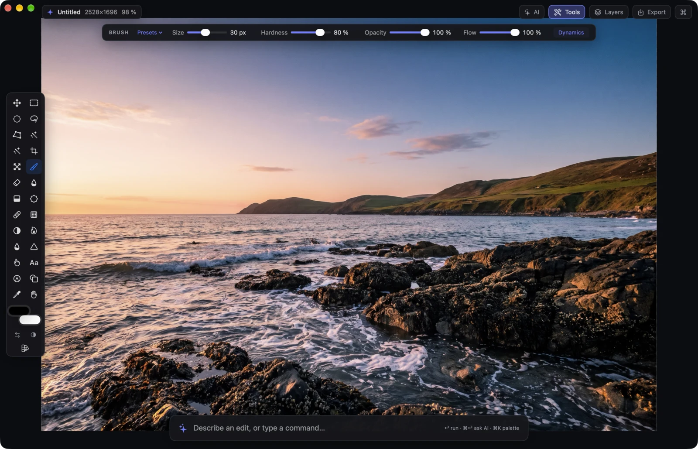

# Getting Started

Glimmer is a photo editor for the Mac. It works with layers, masks, adjustment layers, layer styles, smart objects and text, and it keeps your edits non-destructive where it can. Pixels are stored in 16-bit linear color, so heavy adjustments hold up.

Glimmer also has AI tools. Some run on your Mac, such as subject selection, depth blur and background removal. Others, such as generating, filling, expanding and relighting, go through OpenRouter with your own API key. Everything else works without a key. Until you add one, the AI panel shows a banner that reminds you.

## Requirements

- macOS 27 or later.
- A Mac with Apple silicon.
- For the cloud AI tools: an OpenRouter API key (see [Settings](14-settings.md)).
- For "Understand simple requests on this Mac": Apple Intelligence.

## First launch

### The Welcome window

The first time you open Glimmer, the Welcome window appears, together with an empty document window. The Welcome window sums up what the app does and gives you three buttons:

- **Add OpenRouter Key…** opens **Settings › AI**, where you paste your key. You only need a key for the cloud AI tools.
- **Open Image…** shows the Open panel. Pick a photo, a `.glimmer` document or a Glimmer for the web project.
- **New Document** opens the New Document window. Press ⏎ to choose it.

The Welcome window appears only once. To see it again, choose **Help › Welcome to Glimmer**.

The empty document shows a start card with **Open Image** and the other ways in. When you open an image while that empty document is still untouched, the image takes over its window, so you don't end up with a blank window next to your photo.

### The Agent Access window

On later launches, Glimmer shows the Agent Access window instead of the Welcome window, again with an empty document unless macOS reopens the documents you had open. Glimmer runs a small local server on your Mac (127.0.0.1, port 9001, or the first free port from 9101 to 9119 when 9001 is taken) that AI agents such as Claude can use to open, edit and export images in your open windows. The window shows one line of text to give to your agent. The agent fetches a guide from Glimmer and learns the rest from there.

- Click **Copy** (or press ⇧⌘C) to copy the line, then paste it into your agent.
- Turn off **Show at launch** if you don't want the window at every launch.
- Click **Close** (or press ⏎) to dismiss it.

You can open the window at any time with **Help › Agent Access…**. The **Help** menu also links to this manual and to the FAQ on glimmer.brattoo.com. Turning off **Show at launch** only hides the window. The local server still runs, and it only accepts connections from your own Mac.

## Creating a new document

Choose **File › New…** (⌘N). The New Document window opens.

| Option | What it does |
| --- | --- |
| Preset | Picks a common size: HD 1920 × 1080, 4K 3840 × 2160, Square 1024, Square 2048, Portrait 1080 × 1350, Story 1080 × 1920 or A4 at 150 ppi. Choose **Custom** to type your own. |
| Width, Height | The size in pixels. Each side can be from 1 to 32,768 pixels. |
| Background | White, Black, Transparent or Custom. With Custom, a color well appears so you can pick the color. |

Click **Create** (⏎). Glimmer remembers the size and background you used last.

## Opening images

Choose **File › Open…** (⌘O) and pick one or more files. You can also drag images onto the Glimmer icon in the Dock, or use **Open With › Glimmer** in Finder.

When you open a photo, Glimmer creates a new, untitled document with the photo as its only layer. Your original file is never changed. When you save, you save a `.glimmer` document. See [Documents and Files](02-documents-and-files.md) for formats and other ways to bring images in.

## The window

The editing window is dark and uses the whole window for the canvas. The controls float on top of the image.

### Canvas

The canvas fills the window. The area around the image uses the canvas background color you choose in Settings. Transparent areas show a checkerboard. See [View and Navigation](03-view-and-navigation.md) for zooming and panning.

### Tool palette

The tool palette sits on the left. Click a tool or press its key. Hover over a tool to see its name and key.

| Tool | Key |
| --- | --- |
| Move | V |
| Rectangular Marquee, Elliptical Marquee | M (press again to switch) |
| Lasso, Polygonal Lasso | L (press again to switch) |
| Magic Wand | W |
| Magic Select | A |
| Crop | C |
| Free Transform | T |
| Brush | B |
| Eraser | E |
| Paint Bucket | K |
| Gradient | G |
| Clone Stamp | S |
| Healing Brush | J |
| Pattern Stamp | none |
| Dodge | O |
| Burn | ⇧O |
| Blur, Sharpen, Smudge | none |
| Type | Y |
| Pen | P |
| Shape | U (press again to step through the shapes) |
| Eyedropper | I |
| Hand | H |

Below the tools are the foreground and background colors. Press X to swap them and D to reset them to black and white. The swatches button opens a palette of colors: click a swatch to set the foreground, ⌥-click to set the background. Click **+** to save the current foreground color. Saved swatches are kept for all documents.

### Tool options bar

The bar along the top shows the options for the current tool, with the tool's name on the left. It changes when you change tools. Tools without options don't show it.

### Title chip

The chip in the top-left corner shows the document name, its size in pixels and the zoom level. It also tells you when something is in progress, such as an export or an AI job, and when you are painting on a layer mask.

### Chrome bar

The buttons in the top-right corner:

| Button | What it does |
| --- | --- |
| AI | Shows or hides the assistant and the AI tools. |
| Tools | Shows or hides the tool palette. |
| Layers | Shows or hides the panel with Layers, Paths, Channels and History (⌥⌘L). |
| Export | Opens the Export sheet. |
| ⌘ | Opens the command palette (⌘K). |

### Side panel

The side panel opens below the chrome bar. Use the tabs at the top to switch between:

- **Layers**: the layer stack, with blend modes, opacity, masks and groups.
- **Paths**: saved pen paths.
- **Channels**: the RGB, Red, Green, Blue and Alpha channels of the image. Click a channel to view it alone in gray. Channel views don't change the image.
- **History**: the undo steps since you opened the document. Click a step to go back to it.

The **AI** button shows the same panel with the assistant and the AI tools instead. Click **×** to close the panel. You can also open a tab directly from the command palette: type "Layers Panel", "Paths Panel", "Channels Panel" or "History Panel".

### Omnibar

The bar at the bottom of the window reads "Describe an edit, or type a command…". Click it and type:

- Type a command name, such as "curves" or "flip", and press ⏎ to run the top match. Use ↑ and ↓ to pick another match.
- Describe an edit in plain words, such as "make it warmer", and press ⌘⏎ to ask the assistant.
- Press Esc to leave the bar.

When the bar is empty and you click it, it shows ideas to try. On an empty canvas these are things to generate. On a photo you also get suggestions that Glimmer found by analysing the image on your Mac, such as straightening a tilted horizon.

The omnibar hides while you use Crop, Free Transform or Liquify. You can turn it off in **Settings › General**.

The command palette (⌘K) works the same way in a larger window. With nothing typed, it lists the commands you used last.

### Selection action bar

When you make a selection, a small bar appears next to it. You can describe what to generate inside the selection, remove what's in it, invert it, feather it or deselect. Generating and removing need an OpenRouter key. You can turn the bar off in **Settings › General**.

### The start card

A new, empty document shows a start card in the middle of the canvas. It reminds you that you can drop a file anywhere, paste from the clipboard, open a file, or describe an image in the omnibar to generate one. It has three buttons:

- **Open Image** shows the Open panel.
- **⌘K Commands** opens the command palette.
- **Start Blank** hides the card so you can start painting.

The card disappears as soon as you change the document. If you drop or paste an image into an untouched empty document, the document takes the size of the image.

### Classic layout

If you prefer panels that stay in place, choose **View › Classic Layout**. The side panel then docks to the right edge of the window at full height, with all five tabs: Layers, Paths, Channels, History and AI. The AI and Layers buttons switch the tab instead of hiding the panel. The image is fitted to the new canvas size. Glimmer remembers the choice for all windows. Choose **View › Classic Layout** again to go back.

## Updates

In release builds, **Glimmer › Check for Updates…** checks for a new version. Glimmer also checks on its own from time to time.
