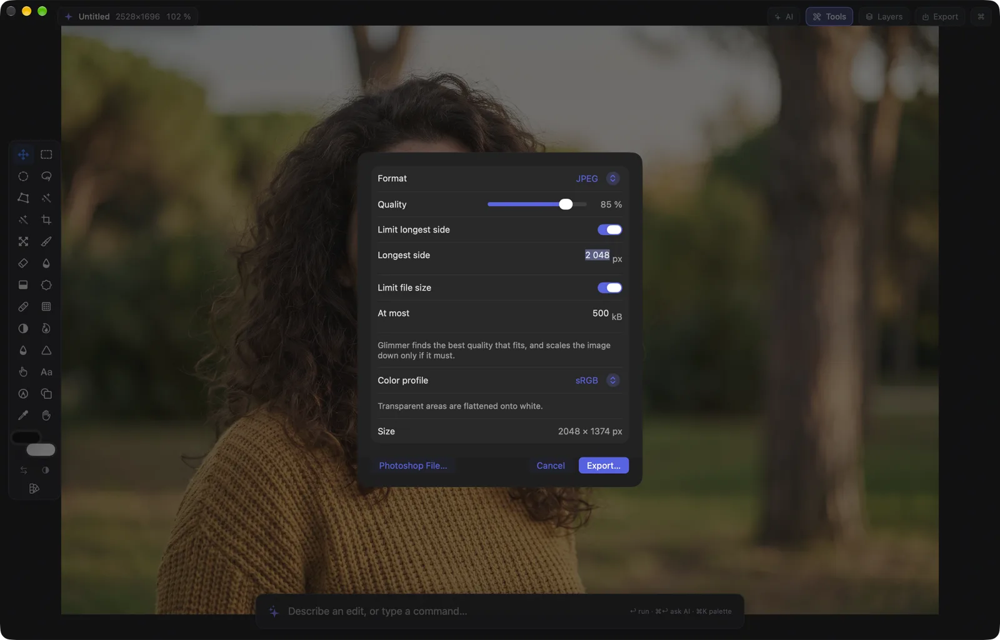
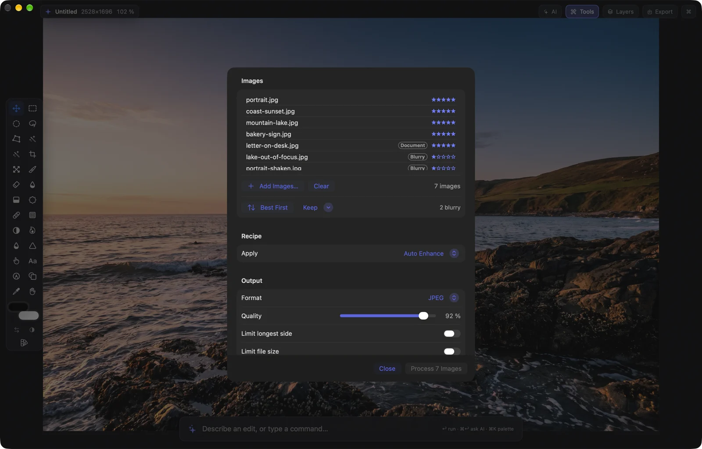

# Documents and Files

This chapter covers how Glimmer saves your work, how you bring images in, and how you get finished images out.

## The .glimmer document

Glimmer saves your work as a `.glimmer` document. It keeps everything you need to go on editing:

- all layers, with their blend modes, opacity, masks, layer styles and clipping;
- adjustment layers, fill layers and shapes, with their settings;
- smart objects and their smart filters;
- editable text layers;
- groups;
- paths from the Pen tool;
- guides, the grid, rulers and the snap setting;
- the document's blending choice (**Image › Blend Colors in Gamma Space**).

The undo history and the current selection are not saved. When you open a document again, the History panel starts empty.

A `.glimmer` document is a package: Finder shows it as one file. Each side can be up to 32,768 pixels.

### How large a document can be

Three things limit a document:

- **Each side** can be up to 32,768 pixels (30,000 in Image Size and Canvas Size).
- **The canvas** must fit your Mac's memory. Glimmer keeps pixels in 16-bit floating point, which takes 8 bytes a pixel, and one full layer may use at most two fifths of the memory. On a Mac with 16 GB that is about 850 megapixels, for example 29,000 × 29,000; on a Mac with 8 GB it is half of that. A larger new document or resize is refused, and the message gives the numbers.
- **Many large layers** matter long before the canvas limit. A measured example: a 6000 × 4000 document with 60 layers (three full-size layers, thirty photo layers, twelve smart objects, layer styles) takes about 5.5 GB of memory and is about 700 MB on disk. How long it takes to save is mostly the speed of the disk. On the external USB disk it was measured on, a save took about 30 seconds, of which about 21 seconds were the writing itself; on the Mac's internal disk, which measured twelve times faster, the same writing takes about 2 seconds (calculated from the disk's speed, not timed). The same document at 12,000 × 8,000 has four times the pixels; by calculation, not measurement, it needs about 20 GB, more than a 16 GB Mac has.

When a document needs more than about three fifths of your Mac's memory, Glimmer tells you once. It keeps working, but it may get slow. Merging layers you no longer need apart, or making the image smaller with **Image › Image Size…**, helps.

An image you open can have up to 256 megapixels.

### Saving and autosave

Glimmer uses the standard Mac document system, so you save, rename, duplicate and move documents with the usual commands in the **File** menu. Choose **File › Save** (⌘S) to give a new document a name and a place.

Glimmer saves your changes in the background as you work. Untitled documents are kept too, so they come back after you quit and reopen Glimmer. To go back to an earlier state of a saved document, use **File › Revert To**.

Every edit is an undo step. Choose **Edit › Undo** (⌘Z) and **Edit › Redo** (⇧⌘Z, or ⌘Y). The menu names the step, for example "Undo Brush Stroke". How many steps Glimmer keeps, and how much memory they may use, is set in **Settings › Performance**.

### Finder previews

Each saved document carries a small thumbnail and a larger preview. Finder uses them for the document's icon, and Quick Look shows the preview when you select the document and press Space.

## Opening images

Choose **File › Open…** (⌘O). The Open panel accepts `.glimmer` documents, images and projects from Glimmer for the web (`.aips`). You can select several files at once.

Glimmer opens any image format that macOS itself can read, such as JPEG, PNG, HEIC, TIFF, WebP, GIF and BMP. For files with several images or pages, Glimmer uses the first one. Each side can be up to 32,768 pixels.

An opened image becomes a new, untitled document with the image as its only layer. The layer takes the file's name. Glimmer never writes back to the original file. When you save, you create a `.glimmer` document, and to get an image file again you export.

The one exception is an image that Flimmer or Jämmer hands you to edit. Then **File › Save Back to** *name* (⌘S) writes it back into the same file, in the same format, when you choose to. Autosave still never touches the file. See [Editing an image for Flimmer](13-automation.md#editing-an-image-for-flimmer).

When Glimmer reads an image, it:

- turns the image upright according to its camera orientation;
- converts the colors from the image's embedded color profile.

You can also open files from Finder: drag them onto the Glimmer icon in the Dock, or Control-click a file and choose **Open With › Glimmer**.

## Photoshop files

Glimmer opens Photoshop files (PSD, and the large-document form PSB) with their layers, as a new, untitled Glimmer document. The Photoshop file itself is never changed. Open one with **File › Open…** or by dragging it onto Glimmer.

What comes through as it was, for RGB and grayscale files with 8 or 16 bits per channel:

- Layers of pixels, with their names, positions, transparency, opacity and visibility.
- Groups, open or closed, and clipping.
- Layer masks, including masks that are switched off.
- The blend modes Glimmer has, which is all of Photoshop's except Dissolve.
- Solid colour fill layers, and shapes filled with one colour: they come in as fill layers with their outline, which you can go on editing.
- Levels, Curves and Invert adjustment layers. A Curves layer from a Photoshop file keeps its points and runs between them as Photoshop draws it.

The document is set to blend colours the way Photoshop does (**Image › Blend Colors in Gamma Space**), so that half-transparent layers look as they did.

What does not come through in this version, and what happens instead:

- **Text** becomes a layer of pixels with the same name. The words can't be edited as text; the report quotes them.
- **Smart objects** become pixels. The file that was placed in them is not kept.
- The other **adjustment layers**, **gradient and pattern fills**, and shapes with an inverted outline are left out.
- **Layer effects** such as shadows, strokes and glows, and **vector masks**, are not read.
- A layer in the **Dissolve** blend mode comes in as Normal.
- Files in **other colour modes** (CMYK, Lab, indexed colour, duotone, multichannel, bitmap) and files with **32 bits per channel** open as one layer: the flattened picture saved in the file, converted to RGB by macOS. Their layers are not read.

Nothing is dropped silently. When the file has opened, an **Import Report** lists, layer by layer, what did not come through and what was done instead; if everything came through, it says so in one line. Glimmer also compares its own picture of the layers with the flattened picture that the file carries, and the report says whether they match or how much they differ. The report is saved with the Glimmer document: **File › Import Report…** shows it again, also after you have closed and reopened the document.

A file larger than Glimmer's limit for your Mac is refused, with the same message as for other images. A damaged file is refused with a reason rather than opened in part.

Glimmer reads these files with its own code, written from Adobe's published description of the format. What that has been tried against:

- Files that Glimmer's own tests generate, and fifty small test files from two open-source projects, most of them written by Photoshop, and two large layered files (the larger a 228 MB PSB of 3,642 × 2,160 pixels with ten layers, nine of them smart objects).
- In those files, Glimmer's picture of the layers matches the picture saved in the file for: layers of pixels, groups, shapes filled with one colour, layer masks, half-transparent layers, 16 bits per channel, the large-document form PSB, the Normal, Multiply, Darker Color and Lighter Color blend modes, Levels, Curves and Invert adjustment layers, smart objects (as pixels), and text (as pixels) in most of the files.
- Text differs slightly along the edges of the letters in a few files (under 1 % of the pixels). That is consistent with a Photoshop setting for how text is blended, which is not stored in the file; it has not been confirmed.
- The picture differs, and the report says why, for: the Dissolve blend mode, the adjustment layers Glimmer leaves out, layer effects, and vector masks on layers of pixels.
- CMYK and Lab files and files with 32 bits per channel opened as their flattened picture, as described above.
- Eighteen of the files with their ends cut off or single bytes changed, tens of thousands of ways: each was refused or opened, none crashed.

Two things these files taught Glimmer to say:

- A Photoshop file saved with **Maximize Compatibility** off carries no flattened picture. Glimmer still reads its layers, and the report says that there was nothing to compare with. If Glimmer can't read the layers of such a file (CMYK, for example), it refuses the file and says why, rather than open a blank page.
- A shape that has both its outline and a painted mask comes in with the two merged into one mask. It looks the same; the outline can no longer be edited as a path, and the report says so.

The two large files opened in two and six seconds on the Mac they were tried on, with Glimmer's picture matching the file's. What has not been tried: files larger than those, and files from Photoshop versions other than the few that wrote these. If a Photoshop file opens wrongly, the report is the first place to look, and the Photoshop file itself is untouched.

### Exporting a Photoshop file

Choose **File › Export…** and click **Photoshop File…**. A sheet shows what the file will hold before you save it; choose 8 or 16 bits per channel, then **Save…**.

Written as what they are: layers of pixels, groups, masks, names, opacity, visibility, clipping, blend modes, solid colour fills, shapes with their outline, and Levels, Curves and Invert adjustment layers. The file also holds a flattened picture of the whole document, so a program that doesn't read layers still shows the right image.

Written as layers of pixels that look the same: text, smart objects, gradient and pattern fills, and layers with effects. You can't edit them as text, smart objects or effects in the file. Not written as layers: the other adjustment layers; the flattened picture still shows what they do. A mask's feather and density are not written. The sheet lists each of these for your document.

If your document blends colours in linear light (**Image › Blend Colors in Gamma Space** is off, which is Glimmer's default), other programs will blend the same layers differently. The sheet says so, with how different they will look measured on your document, and lets you choose between writing the layers as they are and merging them into one layer that looks right everywhere.

What has been verified: Glimmer reads its own Photoshop files back with every setting above intact and the picture unchanged, and macOS (Preview, Quick Look) shows their flattened picture. The layers have not been tried in Photoshop itself, or in any other program that reads them. Keep the Glimmer document; the Photoshop file is a copy for someone else.

## Adding images to a document

There are three ways to add an image to the document you are working on. Each one adds the image as a new layer, centered on the canvas, above the active layer.

### Place Image

Choose **File › Place Image…** (⌥⌘P) and pick one or more images. Each image becomes its own layer.

### Paste

Choose **Edit › Paste** (⌘V).

- If you copied pixels in Glimmer (⌘C or ⌘X), they are pasted back in place as a new layer called "Pasted Layer".
- Otherwise Glimmer pastes an image from the clipboard. This can be an image file you copied in Finder or image data copied from another app (PNG, TIFF or JPEG).

### Drag and drop

Drag image files from Finder, or an image from another app, onto the canvas.

### Into an empty document

If the document is new and untouched, a placed, pasted or dropped image does not become a layer on the blank canvas. It becomes the document instead, at the image's own size. This is the quickest way to start from a photo in an open window.

### Automatic layer names

When you place, paste or drop an image whose name says nothing about it, such as "IMG_1234", "DSC0042" or "Pasted Layer", Glimmer looks at the image on your Mac and renames the layer after what it shows. A name you chose yourself is never changed.

## Camera RAW files

A camera's RAW file (DNG, CR3, RAF, ORF, RW2 and others) opens as a new document with one layer that keeps the RAW file itself. The picture you see is developed from it, and you can develop it again at any time with other settings, without losing quality: choose **Layer › Develop…** with that layer selected.

The Develop sheet shows the picture and these controls: **Exposure** (in stops), **Temperature** and **Tint** (white balance; tick *Click the picture to set what should be grey* and click something that should be neutral), **Shadows**, and, where the file allows it, **Contrast**, **Sharpness**, **Noise reduction**, **Colour noise reduction**, **Recover highlights** and **Lens correction**. **As Shot** goes back to the camera's own white balance and the standard values. **Develop** puts the new picture in the layer as one undo step.

The picture in the sheet follows the controls as fast as your Mac develops the file. For most cameras that is at once; for very large files (around 50 megapixels) it can lag by up to a second or two, and the first picture after the sheet opens takes a few seconds. A line under the picture says when it is catching up. What you see when it has caught up is what you get.

**Lens correction** uses the correction the camera stored in the file. It reshapes the whole picture a little, not only the corners.

Things to know:

- Glimmer develops RAW files with the decoder built into macOS. Which cameras and recording modes work is decided by macOS, and newer cameras arrive with system updates. Some compressed recording modes are not supported even for cameras that otherwise are; another recording mode of the same camera may work. If macOS gives no developed picture, Glimmer says so and opens the preview stored in the file, if there is one, as an ordinary picture.
- The RAW file is saved inside the Glimmer document, so the document grows by the size of the RAW file. Files over 512 MB are not kept.
- The layer remembers which version of the decoder it was developed with, so an old document looks the same after a system update.
- If you paint on the layer or change its pixels, developing again replaces those changes; the sheet warns you first. Masks, opacity, blend mode and effects stay.
- Sidecar files (XMP) and settings from other programs are not read.

What this has been tried with: files from six cameras and phones (Apple, Google, Canon, Fujifilm, OM System, Panasonic). Files in lossy-compressed modes from two others (Nikon, Sony) were not developed by macOS.

## Glimmer for the web projects (.aips)

Glimmer can exchange projects with Glimmer for the web.

### Importing

Open an `.aips` file with **File › Open…** or from Finder. It opens as a new, untitled document. Layers, masks, layer effects, editable text, vector paths, guides and the grid come across.

### Exporting

Choose **File › Export Web Project (.aips)…** and pick a place. The web app has no fill layers, perspective transforms or smart filters, so those layers are written as plain pixels. Shapes are fill layers in Glimmer, so they become pixels too. Pass-through groups become normal groups. The web app has one style per text layer, so text with single words styled differently is written as pixels, and so is rotated or skewed text. The web app doesn't have Vivid Light, Linear Light, Pin Light, Hard Mix, Subtract or Divide, so those layers get its nearest mode (Hard Light for the four lights, Difference for Subtract, Color Dodge for Divide) and may look different there. Everything else keeps its settings.

## Exporting images

### The Export sheet

Choose **File › Export…** (⌥⇧⌘W), or click **Export** in the chrome bar. Set the options, click **Export…**, and choose a name and place.

| Option | What it does |
| --- | --- |
| Format | PNG, JPEG, HEIC, TIFF or WebP. |
| Bit depth | Shown for formats that store more than 8 bits. PNG: 8-bit or 16-bit. TIFF: 8-bit, 16-bit or 32-bit float (linear). 32-bit float keeps the colors in linear light, including values brighter than white. JPEG, HEIC and WebP are always 8-bit. |
| Quality | JPEG, HEIC and WebP, from 10 % to 100 %. WebP is lossless at 100 % and lossy below. |
| Limit longest side | Scales the image down so its longer side is at most the number of pixels you enter. It starts at 2048 px. Smaller images are not enlarged. |
| Limit file size | JPEG, HEIC and WebP. Enter a maximum in kB (it starts at 500 kB). Glimmer finds the best quality that fits, and scales the image down only if it must. |
| Color profile | sRGB or Display P3. |
| Size | Shows the pixel size of the exported image. |

JPEG has no transparency. Transparent areas are flattened onto white, and the sheet tells you so.

Export flattens the image as you see it on screen, with adjustment layers and layer styles applied. Your document keeps its layers. When the export finishes, a message at the top of the window shows the file name and size. The sheet remembers your settings for the window until you close it.

### Export PNG…

**File › Export PNG…** skips the sheet. It asks only for a name and place, and saves a full-size, 8-bit sRGB PNG with transparency.

### Export for Web…

**File › Export for Web…** opens the Export sheet with settings for the web:

- JPEG at 85 % quality;
- sRGB;
- longest side 2048 px;
- at most 500 kB.

You can change any of the settings before you click **Export…**. The settings stay in the sheet for your next export from that window.

## Batch Process

**File › Batch Process…** applies one recipe to many images and saves the results in a folder. Your originals are not changed.

### Adding images

Drop images or folders onto the list, or click **Add Images…**. For a folder, Glimmer adds the images directly inside it, sorted by name. It does not look in subfolders. You can add `.glimmer` documents too. The same file is never added twice. Click **Clear** to empty the list.

### Rating photos

Before you process, you can let Glimmer pick the best photos. Click **Rate Photos**. Glimmer scores each photo on your Mac for how good it looks and how sharp it is. Nothing is uploaded.

Each row then shows:

- one to five stars;
- a **Blurry** badge if the photo is out of focus or shaken;
- a **Document** badge for screenshots, receipts, documents and other pictures taken to keep information.

Hover over the stars to see the scores behind them. Blurry photos lose stars. Flat graphics and screenshots are never called blurry. The bar shows how many blurry photos there are.

When every photo is rated:

- **Best First** sorts the list from best to worst.
- The **Keep** menu removes photos from the list:
  - **Without Blurry Photos**
  - **Without Documents and Screenshots**
  - **4 Stars and Up**
  - **Best Half**
  - **Best Quarter**

These choices only change the list. They never delete files.

### Recipe

Choose what to do to every image under **Apply**:

| Recipe | What it does |
| --- | --- |
| Auto Enhance | Analyses each photo on your Mac and corrects its tone and color, as **Image › Auto Enhance** does. This is the default. |
| Remove Background | Finds the subject on your Mac and masks out the background. |
| Nothing (convert only) | Changes only the format, size or quality. |
| Presets | Any of the looks: Cinematic Teal & Orange, Vintage Film, B&W Noir, HDR Pop, Golden Hour, Cool Cyberpunk, Matte Fade, Bleach Bypass, Cross Process, Dreamy Soft. |
| Saved actions | Actions you saved from the assistant, if you have any. Steps that need the window or a paid AI job are skipped in a batch. |

If you pick Remove Background with JPEG, the sheet warns you that the background turns white. Choose PNG, HEIC or WebP to keep the transparency.

### Output

| Option | What it does |
| --- | --- |
| Format | PNG, JPEG, HEIC, TIFF or WebP. JPEG is the default. Batch output is 8-bit sRGB. |
| Quality | JPEG, HEIC and WebP. |
| Limit longest side, Limit file size | The same limits as in the Export sheet. |
| Save to | Click **Choose…** to pick the folder for the results. You can create a new folder in the panel. |
| Name suffix | Text added to each file name, for example "-edited". Leave it empty to keep the original names. |

Each result is named after its original, plus the suffix and the new extension. If a file with that name already exists, Glimmer adds a number ("Beach 2.jpg") instead of replacing it.

### Running the batch

Click **Process N Images**. The button is available once you have images and a folder. Glimmer works through the images one at a time and shows the progress. A green check marks each finished image. Images that fail get a warning sign, and the reason is listed below the progress bar. Click **Stop** to cancel. When the batch is done, **Show in Finder** shows the new files.
