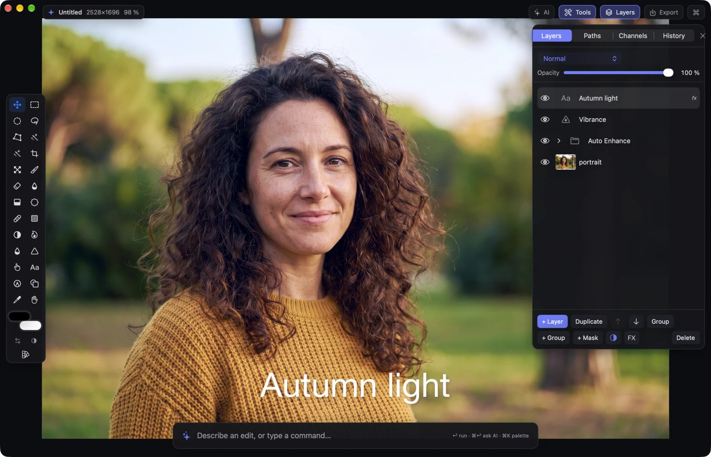

# Layers

A Glimmer document is a stack of layers. Each layer sits on top of the ones below it, and what you see on the canvas is the whole stack blended together. Layers let you keep parts of an image apart, change them later and try things without touching the original pixels.

## Kinds of layers

| Kind | What it holds | How you make one |
| --- | --- | --- |
| Pixel layer | Pixels you paint, paste or place | **Layer › New › New Layer** (⇧⌘N), placing or pasting an image |
| Adjustment layer | A color or tone correction that changes the layers below it | **Layer › New Adjustment Layer** |
| Fill layer | A solid color, a gradient or a pattern that fills the canvas | **Layer › New Fill Layer** |
| Text layer | Editable type | The Type tool (Y) |
| Shape layer | A solid fill layer cut out by a vector shape | The Shape tool (U) |
| Group | Other layers, kept together | **Layer › New › New Group** or **Layer › Group Layer** (⌘G) |
| Smart object | Pixels that keep their original quality through transforms and filters | **Layer › Smart Objects › Convert to Smart Object** |

### Pixel layers

A pixel layer is the only kind you can paint on, erase, clone or liquify. A new pixel layer is empty and transparent. Glimmer names new layers "Layer 1", "Layer 2" and so on.

### Adjustment layers

An adjustment layer holds a correction such as Curves, Levels or Hue/Saturation. It changes everything below it without changing any pixels, so you can edit, hide or delete it at any time. **Image › Adjustments** adds the same adjustment layers. To limit an adjustment to one layer, clip it to that layer (see [Clipping masks](#clipping-masks)).

### Fill layers

A fill layer covers the whole canvas with one of three fills:

- **Solid Color** fills with one color.
- **Gradient** fills with a linear or radial gradient. A new one runs from black to white, left to right.
- **Pattern** fills with a repeating pattern: Checkerboard, Dots, Stripes, Grid or Noise.

Add a mask to a fill layer to show it only in part of the image. The Gradient tool also makes a gradient fill layer when you drag across the canvas, masked by the selection if there is one.

### Text layers

A text layer stays editable: you can change the words, font, size and color later. See [Text, paths and shapes](09-text-paths-and-shapes.md).

### Shape layers

A shape from the Shape tool is a solid color fill layer with a vector mask. The vector mask keeps the outline sharp at any size, and you can recolor the shape, change its outline with the Pen tool, or scale it with Free Transform without losing quality. A shape's outline is a Stroke layer style, so you can change its width and color later.

### Groups

A group holds other layers. Use groups to keep a complex document tidy, or to move, hide, mask or fade several layers at once. A new group uses the Pass Through blend mode (see [Blend modes](#blend-modes)).

### Smart object layers

A smart object keeps its source pixels untouched. Scaling, rotating and distorting only change how it is placed, and filters run on top as smart filters you can edit or remove. See [Smart objects](#smart-objects).

## The Layers panel

Click **Layers** at the top right of the window, or press ⌥⌘L, to show or hide the side panel. The control at the top of the panel switches between **Layers**, **Paths**, **Channels** and **History**.

From top to bottom the Layers tab shows:

1. The **properties** of the active layer, when it has any (adjustment and fill settings, and the layer mask).
2. The **blend mode** menu and the **Opacity** slider for the active layer.
3. The **layer list**, with the top layer first.
4. The **buttons** for common layer commands.

### Layer rows

Each row shows, from left to right:

- **The eye.** Click it to hide or show the layer. A hidden layer's name is dimmed.
- **The thumbnail.** Pixel layers and smart objects show a small picture of their pixels. Smart objects have a small badge. Groups show a folder, adjustment layers a symbol for their kind, solid and gradient fills a swatch of their color, pattern fills a grid and text layers a type symbol.
- **The mask thumbnail**, if the layer has a mask. It is dimmed and crossed out in red while the mask is disabled.
- **The name.** Below it, Glimmer shows the blend mode and opacity when they aren't Normal and 100 %.
- **fx**, when the layer has a layer style turned on.

A clipped layer shows a small bent arrow before its thumbnail. A group has a disclosure arrow; click it to expand or collapse the group. The layers inside an expanded group are indented.

Click a row to make that layer the active layer. Most commands work on the active layer.

To rename a layer, double-click its name, press Return when the Layers panel has the keyboard, or Control-click the row and choose **Rename…**. Press Return to keep the new name or Esc to cancel.

### The row menu

Control-click a layer row for these commands:

- Duplicate Layer
- Rasterize Layer (Merge Group for a group)
- Convert to Smart Object
- Create Clipping Mask or Release Clipping Mask
- Add Layer Mask, or Enable/Disable Layer Mask and Delete Layer Mask when the layer has one
- Layer Style…
- Delete Layer

### Buttons

| Button | What it does |
| --- | --- |
| **+ Layer** | Adds an empty pixel layer above the active layer |
| **Duplicate** | Duplicates the active layer |
| ↑ | Brings the layer forward one step |
| ↓ | Sends the layer backward one step |
| **Group** | Puts the active layer in a new group |
| **+ Group** | Adds an empty group |
| **+ Mask** | Adds a layer mask (Reveal All, or from the selection) |
| Half-filled circle | A menu of every adjustment layer, plus Solid Color Fill, Gradient Fill and Pattern Fill |
| **fx** | Opens Layer Style… |
| **Delete** | Deletes the active layer |

New layers always go directly above the active layer, inside the same group.

### Reordering and grouping by dragging

Drag a row up or down to move the layer in the stack. Drop a row onto a group row to move the layer into that group, at the top of it. You can't drag a group into itself.

## Blend modes

The blend mode decides how a layer's colors mix with the layers below. Choose it from the menu at the top of the Layers tab. The modes come in the same families as in other photo editors:

| Group | Modes | What they do |
| --- | --- | --- |
| Normal | Normal | The layer covers what is below, according to its opacity |
| Darken | Darken, Multiply, Color Burn, Linear Burn, Darker Color | The result is darker; white has no effect in Multiply. Darker Color keeps the whole colour of whichever is darker, the layer or what is below, instead of mixing their channels |
| Lighten | Lighten, Screen, Color Dodge, Linear Dodge (Add), Lighter Color | The result is lighter; black has no effect in Screen. Lighter Color keeps the whole colour of whichever is lighter |
| Contrast | Overlay, Soft Light, Hard Light, Vivid Light, Linear Light, Pin Light, Hard Mix | Darkens the dark parts and lightens the light parts. Vivid Light burns or dodges, Linear Light darkens or lightens by brightness, Pin Light replaces colors, and Hard Mix pushes every channel to full or none, giving flat posterized colors |
| Difference | Difference, Exclusion, Subtract, Divide | Compares colors; useful for comparing layers and for effects. Subtract takes the layer's colors away from the image, Divide brightens by dividing by them |
| Color | Hue, Saturation, Color, Luminosity | Takes one quality of color from the layer and the rest from below |

**Pass Through** appears only for groups, at the top of the menu. A Pass Through group doesn't blend as one unit: each layer inside blends straight into what is below the group, and adjustment layers in the group affect the layers below it too. Pick any other mode and the group is first combined on its own, then blended into the image as one layer. New groups use Pass Through.

### Blend Colors in Gamma Space

By default Glimmer blends layers in linear light, the same as Glimmer for the web. Turn on **Image › Blend Colors in Gamma Space** to blend the way Photoshop does. Use it when a composite should match a file you also work on in Photoshop. The option is saved with the document and you can undo it.

## Opacity

Drag the **Opacity** slider (0 to 100 %) to make the active layer more transparent. Opacity also fades the layer's styles. Each drag is one step in the history.

## Layer masks

A layer mask hides parts of a layer without erasing them. White in the mask shows the layer, black hides it and gray shows it partly. You can always paint the hidden parts back.

### Adding a mask

- **Layer › Layer Mask › Add Layer Mask (Reveal All)** adds a white mask that shows the whole layer. If you have a selection, the mask shows only the selected area instead, and the selection goes away.
- **Layer › Layer Mask › Add Layer Mask (Hide All)** adds a black mask that hides the whole layer.

The **+ Mask** button in the Layers panel works like Reveal All. A layer can have one mask.

### Painting a mask

Click the mask thumbnail in the layer row, or choose **Layer › Layer Mask › Edit Layer Mask** (⌘\\). A colored frame around it shows that you are now working on the mask. Then paint with the Brush (B):

- Paint with black to hide.
- Paint with white to show.
- Paint with gray to show partly.

The mask takes the brightness of the foreground color. With the Eraser (E), the mask takes the brightness of the background color instead. Press D to reset the colors to black and white and X to swap them.

The Brush options also have a **Paint mask** switch when the layer has a mask. Click the layer thumbnail, or press ⌘\\ again, to go back to painting pixels.

### Mask properties

When the active layer has a mask, the top of the Layers tab shows **Layer Mask** with these controls:

- **Enabled** switch. Turns the mask's effect on and off.
- **Density** (0 to 100 %). Lower values make the hidden parts show through. At 0 % the mask has no effect.
- **Feather** (0 to 250 px). Softens the mask's edges without changing what you painted.
- **Invert Default**. Swaps Reveal All and Hide All for the parts of the mask you haven't painted.
- **Delete Mask**.

### Disabling and deleting

- **Layer › Layer Mask › Enable/Disable Layer Mask** switches the mask off and on. The menu item has a check mark while the mask is disabled.
- **Layer › Layer Mask › Delete Layer Mask** removes the mask. On a shape layer it also removes the vector shape, so the fill covers the whole canvas.

## Clipping masks

A clipped layer shows only where the layer below it has pixels. Use it to put a texture inside text, or to make an adjustment affect only one layer.

Choose **Layer › Create/Release Clipping Mask** (⌥⌘G) to clip the active layer, and choose it again to release it. A clipped layer clips to the nearest unclipped layer below it in the same group, so you can clip several layers to one base. The bottom layer of a group can't be clipped. Hiding the base layer hides the layers clipped to it.

## Smart objects

Choose **Layer › Smart Objects › Convert to Smart Object** to turn the active pixel layer or text layer into a smart object. A text layer becomes its pixels and is no longer editable as text.

What a smart object does differently:

- **Transforms stay lossless.** Free Transform changes only how the source is placed. You can scale a smart object down and back up again, rotate it or distort it as often as you like, and it is always drawn fresh from the original pixels.
- **Filters become smart filters.** A filter you apply to a smart object is listed under its row in the Layers panel, under **Smart Filters**. Click the eye to turn a filter off and on. Click the sliders button, or double-click the filter, to change its settings. Control-click it for **Edit…** and **Delete Smart Filter**. Smart filters run in order, top to bottom, after the transform.

You can't paint on a smart object or liquify it. To do that, rasterize it first.

## Rasterize

**Layer › Rasterize Layer** turns the active layer into a plain pixel layer. It works on text layers, fill and shape layers and smart objects. Transforms, warps and smart filters are baked into the pixels. For a group, the command is **Merge Group**: it combines the group's layers into one pixel layer. Adjustment layers can't be rasterized.

Glimmer tells you to rasterize when you try to paint on a layer that has no pixels of its own.

## Layer styles

Layer styles add shadows, glows, outlines and color overlays around a layer's content. They follow the layer as you move or edit it. Styles show on pixel, text and smart object layers and around the outline of shape layers.

Choose **Layer › Layer Style…**, or click **fx** in the Layers panel, to open the Layer Style sheet. Turn on an effect with its switch to see its settings. The canvas shows your changes as you make them. Click **OK** to keep them as one step in the history, or **Cancel** to put the layer back as it was.

### Drop Shadow

A shadow behind the layer, offset away from the light.

| Setting | Range | New shadow |
| --- | --- | --- |
| Color | Any | Black |
| Blend Mode | Any mode except Pass Through | Multiply |
| Opacity | 0 to 100 % | 75 % |
| Angle | −180° to 180° | 120° |
| Distance | 0 to 250 px | 10 px |
| Spread | 0 to 100 % | 0 % |
| Size | 0 to 250 px | 10 px |

The angle is the direction the light comes from: 0° is from the right and the angle grows counterclockwise, so 90° is from above. The shadow falls on the opposite side. Distance is how far the shadow is offset. Size is how soft it is. Spread thickens the shape before it is softened, for a harder edge.

### Inner Shadow

A shadow inside the layer's edges, as if the content were cut into the image. It has the same settings as Drop Shadow. A new inner shadow starts with a distance and size of 5 px.

### Outer Glow

A soft glow around the layer.

| Setting | Range | New glow |
| --- | --- | --- |
| Color | Any | Pale yellow |
| Blend Mode | Any mode except Pass Through | Screen |
| Opacity | 0 to 100 % | 75 % |
| Spread | 0 to 100 % | 0 % |
| Size | 0 to 250 px | 10 px |

### Stroke

An outline along the layer's edges.

| Setting | Range | New stroke |
| --- | --- | --- |
| Color | Any | Red |
| Position | Outside, Inside, Center | Outside |
| Size | 1 to 100 px | 3 px |
| Opacity | 0 to 100 % | 100 % |

### Color Overlay

Covers the layer's content with one color, keeping its shape and transparency.

| Setting | Range | New overlay |
| --- | --- | --- |
| Color | Any | Red |
| Blend Mode | Any mode except Pass Through | Normal |
| Opacity | 0 to 100 % | 100 % |

Color Overlay works on every kind of layer with a picture: pixels, text, smart objects, and fill and shape layers. On a gradient or pattern fill it covers the gradient or pattern with the overlay color; lower the opacity to let it show through.

## Arranging layers

The **Layer › Arrange** submenu moves the active layer among the layers in its group:

| Command | Shortcut |
| --- | --- |
| Bring to Front | ⇧⌘] |
| Bring Forward | ⌘] |
| Send Backward | ⌘[ |
| Send to Back | ⇧⌘[ |

To move a layer into or out of a group, drag it in the Layers panel.

Other commands in the Layer menu:

- **Duplicate Layer** puts a copy named "… copy" above the original.
- **Delete Layer** removes the active layer, or the group with everything in it.
- **Group Layer** (⌘G) puts the active layer in a new group.
- **Ungroup** (⇧⌘G) takes the layers out of the active group and removes the group.

## New Layer via Copy

**New Layer via Copy** copies the selected pixels of the active pixel layer onto a new layer above it. Without a selection it duplicates the whole layer. Choose **Layer › New Layer via Copy** or press ⌘J.

## Properties for adjustments and fills

When the active layer is an adjustment or fill layer, its settings appear at the top of the Layers tab. Changes show on the canvas as you make them, and each drag of a slider is one step in the history.

**Adjustment layers** show the adjustment's sliders, switches and color wells (each adjustment is described in [Adjustments and filters](07-adjustments-and-filters.md)), and a **Reset** button that puts the adjustment back to its starting values. Curves and Levels also have a channel picker (RGB, Red, Green, Blue):

- **Curves**: click the graph to add a point, drag a point to move it, and drag a point off the graph to remove it. Reset clears the curve of the channel you are looking at.
- **Levels**: drag the black, gray and white handles under the histogram, or use the Input Black, Gamma, Input White, Output Black and Output White sliders.
- **Gradient Map**: edit the gradient's stops (see below).

**Fill layers** show:

- **Solid Color**: a **Color** well.
- **Gradient**: **Style** (Linear or Radial), the color stops, **Angle** (−180° to 180°) and **Reverse**. For each stop, pick a color and drag its position slider. Click **Add Stop** to add one, and the minus button to remove one. A gradient needs at least two stops. Changing the angle aims the gradient through the middle of the canvas.
- **Pattern**: **Pattern** (Checkerboard, Dots, Stripes, Grid or Noise), **Scale** (2 to 512 px), and **Foreground** and **Background** colors.

If the layer also has a mask, the mask controls appear below.

## The Channels panel

The Channels tab shows the image's channels: **RGB**, **Red**, **Green**, **Blue** and **Alpha**. The views only change what you see on the canvas, never the image.

- **Click a channel** to see it alone, in gray. Click **RGB** to go back to the normal view.
- **Click the eyes** to combine channels, for example Red and Green without Blue.
- **Alpha** shows the image's transparency: opaque parts are white and transparent parts are black.
- **Show All Channels** appears when you aren't looking at the normal view. Click it to return.
- **The selection button** at the right of a row loads that channel as a selection. Bright areas become selected and dark areas stay unselected. On the RGB row it loads the image's brightness.

## The History panel

The History tab lists every step since you opened the document, starting with **Open**. The current step is highlighted.

Click a step to go back to it. The steps after it are dimmed, and you can click them to go forward again. As soon as you make a new change, the dimmed steps are gone. **Edit › Undo** (⌘Z) and **Edit › Redo** (⇧⌘Z) step through the same list, and the menu items name the step they undo or redo.

Glimmer keeps the last 100 steps. Change the number under **History states** in **Glimmer › Settings › Performance**. When the history needs more memory than allowed, the oldest steps move to disk and load back when you undo that far. Steps on disk share the layers they have in common, so they take much less room than a copy of the document each. If the disk is almost full, Glimmer forgets the oldest steps instead of filling it, and tells you once.
