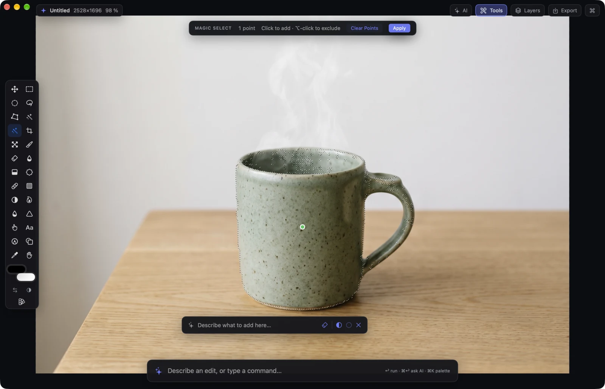
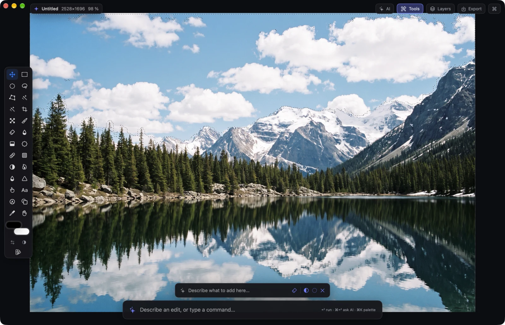

# Selections

A selection marks the part of the image you want to work on. While there is a selection, painting, filling, filters, Copy, Cut and Clear only affect the selected area. Marching ants show its edge on the canvas.

Selections can be soft. A feathered or AI-made selection has partly selected pixels along its edge, so changes blend in smoothly.

## Selection tools

| Tool | Key | Use it for |
| --- | --- | --- |
| Rectangular Marquee | M | Rectangles and squares |
| Elliptical Marquee | M | Ellipses and circles |
| Lasso | L | Freehand outlines |
| Polygonal Lasso | L | Outlines made of straight lines |
| Magic Wand | W | Areas of similar color |
| Magic Select | A | An object you point at |

Press M to switch between the two marquee tools and L to switch between the two lassos.

### Adding, subtracting and intersecting

The marquee tools, the lassos and the Magic Wand all read the modifier keys when you start:

| Hold when you start | Result |
| --- | --- |
| Nothing | A new selection replaces the old one |
| ⇧ | Adds to the selection |
| ⌥ | Subtracts from the selection |
| ⇧⌥ | Keeps only the overlap of the old and new selection |

### Rectangular and Elliptical Marquee

Drag across the canvas to draw the shape. While you drag:

- Hold ⇧ to make a square or a circle.
- Hold ⌥ to draw from the center outward.

If you held ⇧ or ⌥ at the start to add or subtract, let go of the key first. Pressed again during the drag, it then constrains or centers the shape.

With **View › Snap** on, the marquee's edges snap to the canvas edges, the canvas center, guides and the grid. They don't snap while you hold ⇧.

A click without a drag deselects.

### Lasso

Drag to draw the outline freehand. Let go of the mouse to close the shape with a straight line back to the start. A click without a drag deselects.

### Polygonal Lasso

Click to place each corner. A line follows the pointer to show the next edge. To close the shape, do one of these:

- Click the first point.
- Double-click.
- Press Return.

Press Esc to cancel the outline.

### Magic Wand

Click a color in the image to select the area around it that has a similar color. The options bar has:

- **Tolerance** (0 to 255, starts at 32). How different a color can be and still be selected. Low values select only very similar colors.
- **Contiguous**. On: only pixels connected to the one you clicked. Off: every pixel of a similar color in the whole image.
- **Sample all layers**. On: the wand looks at the image as you see it. Off: it looks only at the active layer.
- **Feather** (see [Feather](#feather-as-you-select)).

### Magic Select

Magic Select finds the object you click on and selects it with a detailed outline. It runs on your Mac. The first time you use it, Glimmer downloads its model (about 78 MB). You can manage the model in **Glimmer › Settings › Models**.

1. Click the object. A green point marks the spot, and the selection appears after a moment.
2. If the selection includes too little, click the parts that are missing.
3. If it includes too much, ⌥-click what should be left out. A red point marks the spot.
4. Press Return or click **Apply** to keep the selection.

Each click refines the selection using all the points so far. The options bar shows how many points you have placed.

- **Apply** (Return) keeps the selection and clears the points, so your next click starts a new object.
- **Clear Points** (Esc) clears the points and puts back the selection you had before you started.

Switching to another tool keeps the selection and clears the points.

## Feather as you select

The marquee tools, the lassos and the Magic Wand have a **Feather** slider (0 to 32 px) in the options bar. When it is above 0, each new selection is softened by that many pixels as you make it. To soften a selection you already have, use **Select › Feather…**.

## The Select menu

| Command | Shortcut | What it does |
| --- | --- | --- |
| All | ⌘A | Selects the whole canvas |
| Deselect | ⌘D | Removes the selection |
| Inverse | ⇧⌘I | Selects everything that wasn't selected, and the other way round |
| Subject | | Selects the main subject of the image |
| People | | Selects all the people in the image |
| Sky | | Selects the sky |
| Feather… | | Softens the edge of the selection |
| Expand… | | Grows the selection outward |
| Contract… | | Shrinks the selection inward |

### Subject, People and Sky

These commands look at the image as you see it, with all visible layers, and replace the current selection. They run on your Mac.

- **Subject** selects the most prominent objects or people.
- **People** selects every person Glimmer finds. If there are none, Glimmer tells you.
- **Sky** finds the sky along the top of the image and traces its edge closely, around ridges, cables and branches. The first time, Glimmer downloads the depth model (about 48 MB) and the Magic Select model (about 78 MB). If there is no sky reaching the top edge, Glimmer tells you.

### Feather, Expand and Contract

Each opens a small dialog. Type a number of pixels and click **OK**.

- **Feather…** asks for a **Feather radius**. The edge becomes a soft transition about that wide.
- **Expand…** and **Contract…** ask how many pixels to move the edge by.

## The selection bar

When you have a selection, a small bar appears just below it (or above it, when there isn't room below). It has:

- **A text field**, "Describe what to add here…". Type what should appear in the selection and press Return or click **Generate**. This runs Generative Fill and needs an OpenRouter key in **Glimmer › Settings › AI** (see [AI with OpenRouter](11-ai-with-openrouter.md)).
- **Remove** (eraser). Removes what is inside the selection and fills the area to match its surroundings. This also needs an OpenRouter key.
- **Heal** (bandage). Fills the selection with image from around it, on your Mac and without a key. It suits small things; see [Heal Selection](06-painting-and-retouching.md#heal-selection).
- **Invert**. Same as **Select › Inverse**.
- **Feather**. Opens the Feather dialog.
- **Deselect**. Same as **Select › Deselect**.

The Remove, Heal, Invert, Feather and Deselect buttons show while the text field is empty. Once you type, they make way for **Generate**.

The bar hides while you transform, crop, liquify, edit text, use a filter dialog or the command palette. To turn it off, clear **Show the action bar at the selection** in **Glimmer › Settings › General**.

## Keys for working with selections

| Key | What it does |
| --- | --- |
| Esc | Deselects, when no tool is using Esc for something else |
| ⌫ or ⌦ | Clears the selected pixels on the active pixel layer, leaving them transparent |
| ⌥⌫ | Fills the selection with the foreground color |
| ⌘⌫ | Fills the selection with the background color |

The fill and clear keys work on pixel layers. Without a selection, ⌥⌫ and ⌘⌫ fill the whole layer.

To turn a selection into a mask that you can keep and edit, choose **Layer › Layer Mask › Add Layer Mask (Reveal All)** while the selection is active. See [Layers](04-layers.md#layer-masks).
