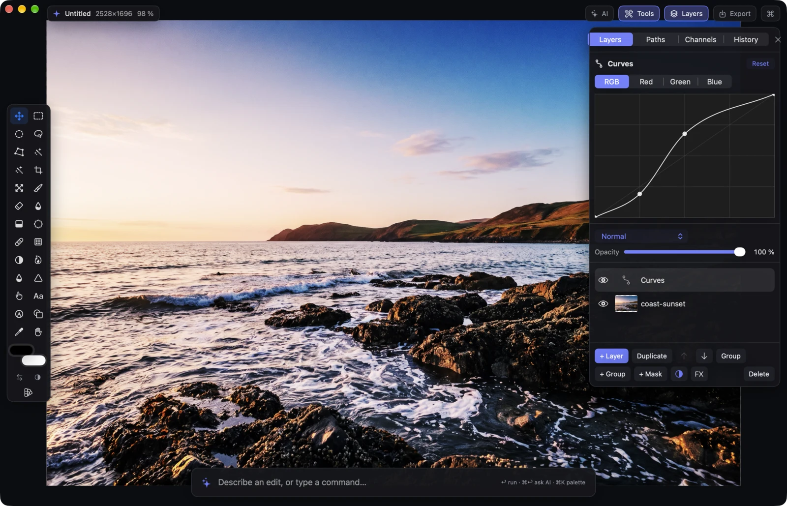

# Adjustments and filters

Glimmer changes tone and color in two ways.

- **Adjustment layers** sit in the layer stack and change how the layers below them look. They never touch pixels. You can change their settings, hide them, mask them or delete them at any time.
- **Filters** change the pixels of a layer when you click OK. Blur, sharpen, noise and the other effects in the Filter menu are filters. To keep a filter editable, apply it to a smart object (see [Smart filters](#smart-filters)).

Use adjustment layers for tone and color. Use filters for effects that need neighbouring pixels, such as blurring and sharpening.

## Adjustment layers

### Adding an adjustment

Choose an adjustment from **Image › Adjustments** or **Layer › New Adjustment Layer**. Both menus have the same 14 items and both add an adjustment layer. You can also type the name in the command palette (⌘K).

The new layer goes directly above the active layer and becomes the active layer. It affects everything below it in the stack. To limit it to the one layer directly below, make it a clipping mask with **Layer › Create/Release Clipping Mask** (⌥⌘G). To limit it to part of the image, make a selection first and then add a mask with **Layer › Layer Mask › Add Layer Mask (Reveal All)**, or paint the adjustment layer's mask.

### Editing an adjustment

When an adjustment layer is active, its settings appear at the top of the Layers panel.

- Each slider shows its current value. Dragging a slider is one undo step.
- **Reset** at the top right puts every setting back to its default. In Curves it resets only the channel you are looking at.
- You see the result on the canvas while you drag.

Most sliders show values with two decimals. The ranges below are the values the slider shows.

### Brightness/Contrast

| Slider | Range | Default |
|---|---|---|
| Brightness | −1.00 to 1.00 | 0.00 |
| Contrast | −1.00 to 1.00 | 0.00 |

Brightness shifts all tones up or down. Contrast spreads tones away from the middle gray or pulls them toward it.

### Levels

Levels sets the black point, white point and midtone brightness. It has a channel picker (**RGB**, **Red**, **Green**, **Blue**), a histogram and five sliders.

The histogram shows the image below the Levels layer, for the channel you picked. Under the histogram are three handles you can drag:

- the black handle sets Input Black,
- the gray handle sets Gamma,
- the white handle sets Input White.

| Slider | Range | Default | What it does |
|---|---|---|---|
| Input Black | 0.00 to 1.00 | 0.00 | Tones at or below this become black. |
| Gamma | 0.10 to 9.99 | 1.00 | Brightens (above 1) or darkens (below 1) the midtones. |
| Input White | 0.00 to 1.00 | 1.00 | Tones at or above this become white. |
| Output Black | 0.00 to 1.00 | 0.00 | The darkest tone the result can have. Raise it for faded blacks. |
| Output White | 0.00 to 1.00 | 1.00 | The brightest tone the result can have. |

Each channel has its own settings. Switch the picker to Red, Green or Blue to correct a single channel, for example to remove a color cast. The Red, Green and Blue settings are applied first, then the RGB settings on top.

### Curves

Curves maps every input tone to an output tone. The horizontal axis is the input, from black on the left to white on the right. The vertical axis is the output.

- **Click** on the graph to add a point and drag it.
- **Drag** a point to move it. Points can't pass their neighbors.
- **Drag a point off the graph** to remove it. The two end points can be moved but not removed.
- **With the keyboard:** click the graph (or Tab to it with Full Keyboard Access). A ring marks one point. The arrow keys move it by one level of 0–255, ⇧ with an arrow by ten, and ⌥← ⌥→ mark the previous or next point. The end points move only up and down.

Use the channel picker (**RGB**, **Red**, **Green**, **Blue**) to choose which curve you edit. Channels you have already changed are drawn faintly behind the current curve, each in its own color. The Red, Green and Blue curves are applied first, then the RGB curve.

**Reset** clears only the curve of the channel you are looking at, so you can undo a red-channel change without losing the RGB curve.

A gentle S shape (darker shadows, brighter highlights) adds contrast. Raising the left end point gives faded, matte blacks.

### Exposure

| Slider | Range | Default | What it does |
|---|---|---|---|
| Exposure | −5.00 to 5.00 | 0.00 | Brightness in stops. +1 doubles the light. |
| Offset | −0.50 to 0.50 | 0.00 | Lifts or lowers the darkest tones. |
| Gamma Correction | 0.10 to 3.00 | 1.00 | Brightens or darkens the midtones. |

Exposure works in linear light, like changing the exposure in the camera. Moderate values (±0.3 to ±1) usually look natural.

### Hue/Saturation

| Slider | Range | Default | What it does |
|---|---|---|---|
| Hue | −180 to 180 | 0 | Rotates all colors around the color wheel, in degrees. |
| Saturation | −1.00 to 1.00 | 0.00 | −1 removes all color; positive values make colors stronger. |
| Lightness | −1.00 to 1.00 | 0.00 | Moves tones toward black (negative) or white (positive). |

### Vibrance

| Slider | Range | Default | What it does |
|---|---|---|---|
| Vibrance | −1.00 to 1.00 | 0.00 | Strengthens muted colors more than colors that are already strong. |
| Saturation | −1.00 to 1.00 | 0.00 | Changes all colors by the same amount. |

Vibrance is gentler on skin tones and already-saturated areas than Saturation.

### Color Balance

Color Balance shifts the color separately in the shadows, midtones and highlights. There are nine sliders, three for each tonal range, all from −1.00 to 1.00 with a default of 0.00.

| Tonal range | Sliders |
|---|---|
| Shadows | Shadows: Cyan – Red, Shadows: Magenta – Green, Shadows: Yellow – Blue |
| Midtones | Midtones: Cyan – Red, Midtones: Magenta – Green, Midtones: Yellow – Blue |
| Highlights | Highlights: Cyan – Red, Highlights: Magenta – Green, Highlights: Yellow – Blue |

Moving a slider to the right adds the color on the right of its name (red, green or blue). Moving it left adds the opposite color.

**Preserve Luminosity** (on by default) keeps the brightness of each pixel the same while the color changes.

### Black & White

Black & White turns the image into grayscale. Six sliders set how bright each color range becomes in the result.

| Slider | Range | Default |
|---|---|---|
| Reds | −2.00 to 3.00 | 0.40 |
| Yellows | −2.00 to 3.00 | 0.60 |
| Greens | −2.00 to 3.00 | 0.40 |
| Cyans | −2.00 to 3.00 | 0.60 |
| Blues | −2.00 to 3.00 | 0.20 |
| Magentas | −2.00 to 3.00 | 0.80 |

Higher values make that color lighter in the grayscale image. For example, lower Blues to darken a blue sky, or raise Reds to lighten skin.

### Photo Filter

Photo Filter tints the image like a colored filter in front of the lens.

| Control | Range | Default | What it does |
|---|---|---|---|
| Density | 0.00 to 1.00 | 0.25 | Strength of the tint. |
| Preserve Luminosity | toggle | on | Keeps the image's brightness while it is tinted. |
| Filter Color | color well | warm orange | The color of the filter. Click to choose another. |

### Channel Mixer

Channel Mixer builds each output channel from a mix of the input channels. There are twelve sliders, all from −2.00 to 2.00.

| Output | Sliders | Defaults |
|---|---|---|
| Red | R ← Red, R ← Green, R ← Blue, R ← Constant | 1, 0, 0, 0 |
| Green | G ← Red, G ← Green, G ← Blue, G ← Constant | 0, 1, 0, 0 |
| Blue | B ← Red, B ← Green, B ← Blue, B ← Constant | 0, 0, 1, 0 |

"R ← Green" is how much of the input green channel goes into the output red channel. The Constant sliders add or remove a fixed amount from that output channel.

**Monochrome** (off by default) makes a grayscale image from the red output mix. Turn it on and adjust the three R sliders to set how much each channel contributes.

### Invert

Invert turns the image into its negative. It has no settings.

### Posterize

| Slider | Range | Default |
|---|---|---|
| Levels | 2 to 255 | 4 |

Posterize reduces each channel to the given number of tones, which gives flat areas of color.

### Threshold

| Slider | Range | Default |
|---|---|---|
| Threshold Level | 0.00 to 1.00 | 0.50 |

Threshold makes every pixel pure black or pure white. Pixels brighter than the level become white.

### Gradient Map

Gradient Map replaces each tone with a color from a gradient: the darkest tones take the color at the left end, the brightest tones the color at the right end. The default runs from black to white, which gives a plain grayscale image.

The gradient editor shows a preview bar and one row per stop:

- Click a stop's color well to change its color.
- Drag the slider to move the stop.
- Click the minus button to remove a stop. A gradient keeps at least two.
- **Add Stop** adds a stop in the middle with the color already there.

## Filters

### Applying a filter

The **Filter** menu groups the filters into submenus: **Blur**, **Sharpen**, **Noise**, **Pixelate**, **Stylize** and **Lens**. Filters are also in the command palette (⌘K).

Filters work on the active layer when it is a pixel layer with content, or a smart object. On any other layer the filter items are unavailable.

When there is a selection, the filter changes only the selected area.

### The filter sheet

Most filters open a sheet with their settings. The canvas shows a live preview while you move the sliders. A small spinner in the sheet's title row means the preview is still being worked out.

| Control | What it does |
|---|---|
| Sliders and toggles | The filter's settings (listed below). |
| Applies to the selection | Shown when there is a selection. |
| Preview | Turn off to see the layer without the filter. |
| Reset | Puts every setting back to its default. |
| Cancel (Esc) | Closes the sheet without changing anything. |
| OK (Return) | Applies the filter. This is one undo step. |

When you open the same filter again, the sheet starts with the settings you used last time.

Find Edges has no settings and is applied as soon as you choose it.

### Repeat Last Filter

**Filter › Repeat Last Filter** (⌃⌘F) applies the last filter again with the same settings, without opening the sheet. It works on another layer too, which is handy for giving several layers the same blur or sharpening.

### Blur

**Filter › Blur › Gaussian Blur…**

| Setting | Range | Default |
|---|---|---|
| Radius | 0 to 100 px | 4 px |

An even, smooth blur.

**Filter › Blur › Lens Blur…**

| Setting | Range | Default |
|---|---|---|
| Radius | 0 to 60 px | 8 px |
| Highlight Bloom | 0.00 to 1.00 | 0.30 |

A blur that looks like an out-of-focus lens. Highlight Bloom makes bright spots glow and spread.

This filter blurs the whole layer (or selection) evenly. **AI › Lens Blur…** is a different feature that estimates depth and blurs the background; see [Lens Blur with depth](10-on-device-intelligence.md#lens-blur-with-depth).

**Filter › Blur › Motion Blur…**

| Setting | Range | Default |
|---|---|---|
| Angle | −180° to 180° | 0° |
| Distance | 0 to 200 px | 20 px |

Smears the image in one direction, as if the camera or subject moved.

### Sharpen

**Filter › Sharpen › Sharpen…**

| Setting | Range | Default |
|---|---|---|
| Amount | 0.00 to 5.00 | 1.00 |

A simple sharpening of fine edges.

**Filter › Sharpen › Unsharp Mask…**

| Setting | Range | Default | What it does |
|---|---|---|---|
| Amount | 0.00 to 5.00 | 0.80 | Strength of the sharpening. |
| Radius | 0.5 to 10 px | 2 px | How wide the sharpened edges are. |
| Threshold | 0.00 to 1.00 | 0.00 | Leaves areas with little contrast alone. Raise it to avoid sharpening noise and smooth skin. |

**Filter › Sharpen › Clarity…**

| Setting | Range | Default |
|---|---|---|
| Amount | −1.00 to 1.00 | 0.40 |

Adds midtone contrast over a wide area, which brings out texture and detail. Negative values soften it.

### Noise

**Filter › Noise › Add Noise…**

| Setting | Range | Default |
|---|---|---|
| Amount | 0.00 to 1.00 | 0.10 |
| Monochromatic | toggle | off |

Adds grain. Turn on Monochromatic for grain without color speckles, like film grain.

### Pixelate

**Filter › Pixelate › Pixelate…**

| Setting | Range | Default |
|---|---|---|
| Cell Size | 2 to 200 px | 10 px |

Turns the image into square blocks of a single color.

**Filter › Pixelate › Halftone…**

| Setting | Range | Default |
|---|---|---|
| Cell Size | 2 to 40 px | 8 px |
| Angle | 0° to 90° | 45° |
| Monochrome | toggle | on |

Turns the image into a pattern of dots, like print in a newspaper. Turn off Monochrome for overlapping cyan, magenta and yellow dots.

### Stylize

**Filter › Stylize › Find Edges**

No settings. Shows the edges in the image as dark lines on a light background.

**Filter › Stylize › Emboss…**

| Setting | Range | Default |
|---|---|---|
| Angle | −180° to 180° | 135° |
| Amount | 0.00 to 5.00 | 1.00 |

Makes the image look pressed into a surface, lit from the given angle.

**Filter › Stylize › Oil Paint…**

| Setting | Range | Default |
|---|---|---|
| Radius | 1 to 10 px | 4 px |
| Intensity | 0.00 to 1.00 | 1.00 |

Turns detail into patches of color that look painted.

### Lens

**Filter › Lens › Vignette…**

| Setting | Range | Default | What it does |
|---|---|---|---|
| Amount | 0.00 to 1.00 | 0.50 | How dark the corners get. |
| Midpoint | 0.00 to 1.00 | 0.50 | How far from the center the darkening starts. |
| Roundness | 0.00 to 1.00 | 0.50 | The shape of the vignette. 0 is a circle; 1 follows the proportions of the image. |
| Feather | 0.01 to 1.00 | 0.50 | How soft the transition is. |

**Filter › Lens › Chromatic Aberration…**

| Setting | Range | Default |
|---|---|---|
| Amount | 0 to 40 px | 6 px |
| Stronger at Edges | toggle | on |

Pulls the red and blue channels apart from the center of the image, which gives colored fringes like a cheap lens. With Stronger at Edges on, the fringes stay weak near the center and grow quickly toward the edges.

## Smart filters

A filter on a smart object does not change its pixels. It is added to the smart object as a smart filter that you can change or remove later.

1. Select the layer and choose **Layer › Smart Objects › Convert to Smart Object**. This works on pixel layers with content and on text layers. See the [Layers](04-layers.md) chapter for more on smart objects.
2. Apply any filter. The filter sheet and live preview work as usual.
3. When you click OK, the filter appears under the layer in the Layers panel, in a **Smart Filters** list.

Each smart filter in the list has:

- an eye button to hide or show it,
- a settings button that reopens the filter sheet with its current settings (you can also double-click the filter),
- a right-click menu with **Edit…** and **Delete Smart Filter**.

Smart filters are listed in the order you added them. Repeat Last Filter on a smart object adds the filter again as another smart filter.

Liquify does not work on smart objects; it needs a pixel layer.

## Presets

Presets are finished looks made from adjustment layers and, for some, a few filters. Choose **AI › Presets…** to open the presets panel, then click a tile. Hold the pointer over a tile to see a short description.

When you apply a preset:

- its adjustments are added as a group of adjustment layers, named after the preset, above the active layer. You can open the group and change or delete any part of it.
- its filters (such as grain, clarity or a vignette) are applied to the active pixel layer. These change pixels. If the active layer is not a pixel layer, Glimmer adds the adjustments and tells you which filters it skipped. Select a pixel layer and apply the preset again to include them.

The whole preset is undone with ⌘Z.

| Preset | Look | Adjustments | Filters |
|---|---|---|---|
| Cinematic Teal & Orange | Warm skin tones with teal shadows. | Curves, Color Balance, Vibrance | Clarity |
| Vintage Film | Faded 1970s film: lifted blacks, warm cast, fine grain. | Levels, Photo Filter, Hue/Saturation, Curves | Add Noise |
| B&W Noir | High-contrast black and white with deep shadows and grain. | Black & White, Curves | Vignette, Add Noise |
| HDR Pop | Strong detail and saturation. | Curves, Vibrance | Clarity, Sharpen |
| Golden Hour | Warm sunset light with soft, lifted shadows. | Photo Filter, Color Balance, Levels, Vibrance | none |
| Cool Cyberpunk | Magenta highlights and blue shadows. | Color Balance, Curves, Hue/Saturation | Chromatic Aberration, Vignette |
| Matte Fade | Flattened blacks and muted color. | Levels, Curves, Vibrance, Color Balance | none |
| Bleach Bypass | Desaturated, high contrast, slightly silvery. | Hue/Saturation, Curves, Color Balance | Clarity, Add Noise |
| Cross Process | Green shadows and yellow highlights, like film developed in the wrong chemicals. | Curves, Color Balance, Hue/Saturation | none |
| Dreamy Soft | Soft contrast, pastel colors and a slight glow. | Levels, Vibrance, Photo Filter, Gradient Map | Lens Blur |

Golden Hour, Matte Fade and Cross Process use only adjustment layers, so they are fully non-destructive on any layer.

## Auto Enhance and Auto Color

Both commands analyze the image on your Mac and add ordinary adjustment layers that you can edit afterwards. They are covered in more detail in [Automatic corrections](10-on-device-intelligence.md#automatic-corrections).

- **Image › Auto Enhance** (⇧⌘L) corrects tone and color. It adds a group named **Auto Enhance** with the adjustment layers it needs, at the top of the layer stack. If the image already looks balanced, it tells you and adds nothing.
- **Image › Auto Color** (⇧⌘B) removes a color cast. It adds a Color Balance layer named **Auto Color** at the top of the stack. If there is no cast worth correcting, it tells you and adds nothing.

To see the result without the correction, hide the group or layer. To make the correction weaker, lower the layer's opacity in the Layers panel.
