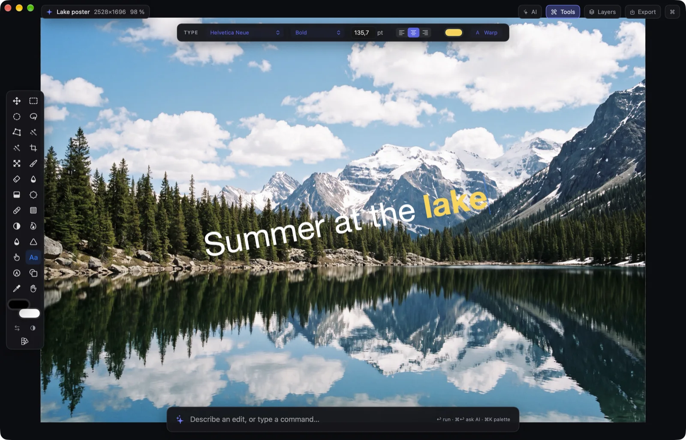
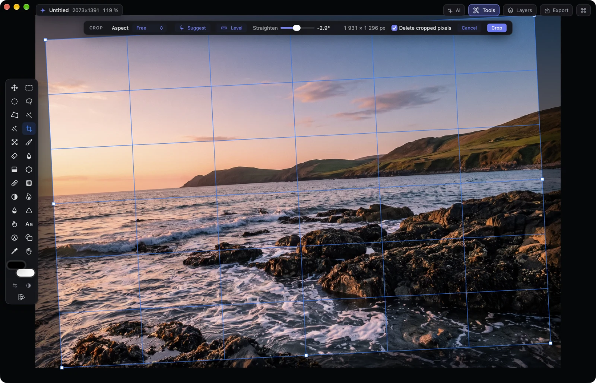

# Transform, crop and image

This chapter covers changing the size, angle and shape of a layer with Free Transform, cutting the canvas down with the Crop tool, and the commands in the Image menu that straighten, rotate and flip the whole image.

## Free Transform

Free Transform scales, rotates, moves and distorts the active layer. Choose **Image › Free Transform** (⌘T), or press T for the Free Transform tool.

It works on:

- **Pixel layers.** The layer's pixels are resampled when you apply the transform.
- **Text layers.** Scaling, rotating and skewing keep the text editable: the transform is stored with the text, and you can still change its words, font and color (the editor shows it turned like the text). Distort and perspective can't keep text editable, so when you apply one, Glimmer asks first, saying how many text layers would become pixels; **Cancel** keeps the box so you can change it. Undo brings the text back.
  
- **Shape layers.** The vector shape is transformed, so edges stay sharp.
- **Smart objects.** Only the placement changes. The original pixels are kept, so you can transform again later without losing quality.

- **Groups.** Every pixel, text, shape and smart object layer inside the group is transformed together with one box, as one undo step: pixels are resampled, text stays editable (as above, with the same question for distort and perspective), shapes stay sharp and smart objects keep their original pixels. Adjustment layers and plain fill layers in the group are left as they are, since they have nothing to place. Layer masks inside the group, and the group's own mask, go through the same transform, so they stay in line with their layers.

Adjustment layers and plain fill layers on their own can't be transformed.

### The transform box

A box with eight handles appears around the layer's content.

| Action | Result |
| --- | --- |
| Drag inside the box | Moves the layer |
| Drag a corner handle | Scales in both directions, keeping the proportions |
| ⇧-drag a corner handle | Scales width and height separately |
| Drag an edge handle | Stretches in one direction; the opposite edge stays put |
| Drag just outside a corner | Rotates around the center of the box |
| ⇧-drag to rotate | Rotates in 15° steps |
| ⌘-drag a corner | Distorts: moves that corner on its own |

The rotation area reaches about 32 points out from each corner. While you rotate, the angle is shown in the middle of the box.

### Options bar

- **Mode**: **Scale & Rotate**, **Distort**, **Skew** or **Perspective**.
  - **Distort**: drag any corner anywhere. Drag an edge handle to move that whole edge.
  - **Skew**: drag an edge to slant it along its own direction.
  - **Perspective**: drag a corner, and the corner next to it on the same top or bottom edge moves the opposite way, as when you tilt a flat surface away from you.
- **W** and **H**: the width and height as a percentage of the original. Type a value to set it.
- **∠**: the rotation in degrees. Type a value to set it.
- **Cancel** and **Apply**.

The W, H and ∠ fields are only there while the box is still a rectangle. Once you distort, skew or use perspective, the box stays a free four-cornered shape. Glimmer won't let a corner cross over and fold the shape inside out.

### Applying and canceling

- Press Return or click **Apply** to apply.
- Press Esc or click **Cancel** to put the layer back.
- Click on the canvas well away from the box to apply.
- Choosing another tool also applies.

Each transform is one step in the history. After you apply or cancel, Glimmer switches to the Move tool.

## The Crop tool

The Crop tool trims the canvas to a rectangle, and can straighten the image at the same time. Choose **Image › Crop**, or press C.

The crop box starts around the whole image. The area outside the box is darkened, and lines inside the box divide it in thirds. While you straighten, the grid gets finer to help you line things up.

### Drawing and adjusting the box

- **Drag on the image** to draw a new box. While the box still covers the whole image, dragging anywhere draws a new one.
- **Drag inside the box** to move it.
- **Drag a handle** on a corner or an edge to resize the box.
- **Drag outside the box** to draw a new one.
- **Click** outside the box without dragging to put the box back around the whole image.

Modifier keys while you drag:

- **⇧** makes a new box square. When you resize, it keeps the box's current proportions.
- **⌥** draws a new box from the center outward. When you resize, the opposite edge moves too, so the box stays centered.

With **View › Snap** on, the box snaps to the canvas edges, the canvas center, guides and the grid.

### Options bar

| Control | What it does |
| --- | --- |
| **Aspect** | Free, Original, 1:1, 4:3, 3:2, 16:9, 4:5 or 9:16. Picking a ratio fits the box to it around its center, and the box keeps that ratio as you resize it. Original is the image's own ratio. |
| **Suggest** | Moves the box to frame the subject at the current aspect ratio. See [Suggest Crop](#suggest-crop). |
| **Level** | Finds a tilted horizon and straightens the box to match. See [Auto Straighten](#auto-straighten). |
| **Straighten** | Rotates the box from −45° to 45° around its center. The box shrinks as needed so it stays inside the image. |
| Size | The size of the result in pixels. |
| **Delete cropped pixels** | On: pixels outside the box are thrown away. Off: they are kept outside the canvas, and you can move a layer to bring them back into view later. Glimmer remembers this setting. |
| **Cancel** | Leaves the image as it was. |
| **Crop** | Crops the image. |

Press Return to crop or Esc to cancel. Either way Glimmer switches to the Move tool.

### What cropping changes

Cropping changes the canvas size for every layer. Paths and guides move with the image, and the selection is removed.

A straightened crop (any angle other than 0°) rotates every layer into the new box. Pixels outside the box are always thrown away, whatever the Delete cropped pixels setting is, because they would no longer line up with the canvas. Text layers become pixel layers. Smart objects and gradient fills keep their settings and are rotated along.

## Suggest Crop

**Image › Suggest Crop** opens the Crop tool with a box that frames the image well. Glimmer analyzes the image on your Mac.

- **With faces in the image**, the box frames the people as head-and-shoulders shots, with the faces about a third of the way down.
- **Without faces**, the box frames the part of the image that draws the eye. With no aspect ratio chosen, it tightens around the subject at the image's own proportions, but never below 55 % of the image's width and height. With an aspect ratio that differs from the image's, it slides the largest box of that ratio over the subject.

If the whole image already frames the subject well, Glimmer tells you and leaves the box as it is. You can adjust the suggested box before you click **Crop**. Inside the Crop tool, the **Suggest** button does the same thing at the aspect ratio you have chosen.

## Auto Straighten

**Image › Auto Straighten** looks for a tilted horizon. When it finds one, it opens the Crop tool with the box already rotated to level it, so you can check the result before you click **Crop**. If there is no tilted horizon, Glimmer tells you. The **Level** button in the Crop tool does the same thing.

## Straighten Document

**Image › Straighten Document** looks for a rectangular object photographed at an angle, such as a sheet of paper, a receipt, a sign, a whiteboard or a screen. It corrects the perspective so the object becomes a flat rectangle and opens the result as a **new document**. Your original document stays as it was.

If Glimmer can't find such an object, it tells you.

## Rotating and flipping the image

These commands in the **Image** menu turn or mirror the whole image, with every layer:

- **Rotate 90° Clockwise**
- **Rotate 90° Counterclockwise**
- **Rotate 180°**
- **Flip Horizontal**
- **Flip Vertical**

A quarter turn swaps the canvas width and height. Masks, shapes and paths turn with the image. Text layers become pixel layers. Smart objects and gradient fills keep their settings. Guides and the selection are removed. Afterwards the view fits the image to the window.

To flip or rotate a single layer, use Free Transform instead.

## Rotating the view

**View › Rotate View Left 15°** and **View › Rotate View Right 15°**, and the two-finger rotate gesture on a trackpad, turn only your view of the canvas, for example to paint at a comfortable angle. They don't change the image. **View › Reset View Rotation** turns the view back.
