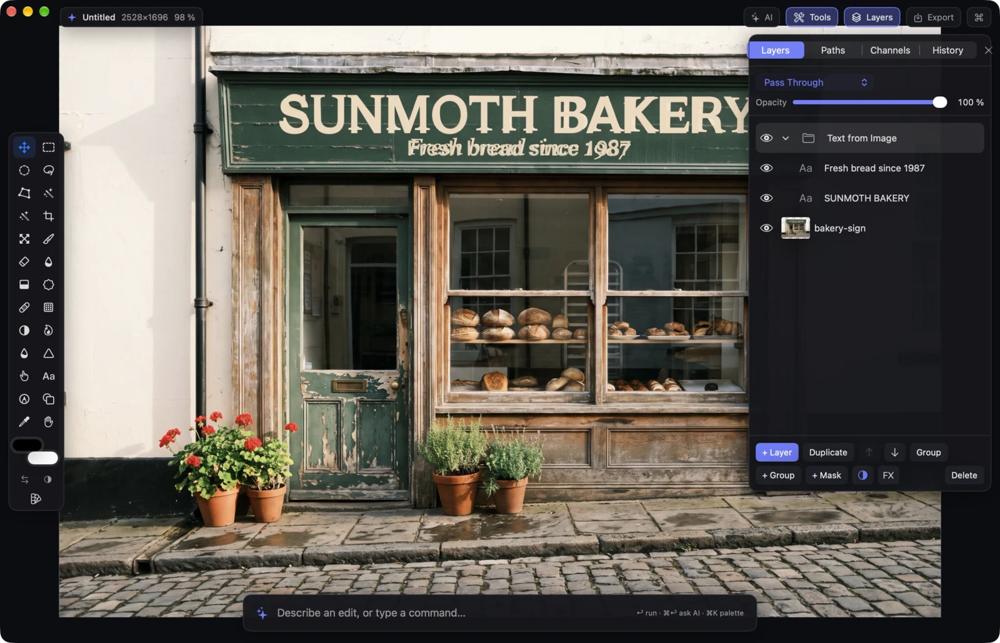

# Text, paths and shapes

Glimmer has three tools that draw with outlines instead of pixels. The Type tool makes editable text layers, the Pen tool draws paths, and the Shape tool makes shape layers. All three stay editable after you make them.

## The Type tool

Press Y or choose the Type tool.

### Adding text

1. Click where the text should start. Glimmer adds a new text layer above the active layer and shows a text cursor.
2. Type. Press Return to start a new line.
3. Press Esc to finish. ⌘Return and Enter on the numeric keypad also finish.

Clicking on the canvas or choosing another tool also finishes the text. If you leave a text layer empty, Glimmer removes it. The layer is named after the first line of text.

New text uses the foreground color. The first text in a session uses Helvetica Neue Bold at 96 pt.

### Editing text

- With the Type tool, click on a text layer to edit it.
- With the Move tool (V), double-click a text layer. Glimmer switches to the Type tool and opens the text for editing.

While you are editing, clicking another text layer moves straight into that one.

### Type options

The options bar shows these controls. They change the active text layer right away. When the active layer isn't a text layer, they set the style for the next text you add. Glimmer also remembers the font, size and alignment you last used for new text.

| Control | What it does |
| --- | --- |
| Font | The font family |
| Style | The style within the family, such as Regular, Bold or Italic |
| Size | The size in points (1 pt is one pixel in the document) |
| Align | Left, center or right |
| Color | The text color |
| On path | Runs the text along a path (only shown when the document has paths) |
| Warp | Bends the text into a shape (not for text on a path) |

When you aren't editing the text, the options change the whole text layer. A change to the font, size or color then applies to every word, including words you styled on their own.

### Styling single words

Words and letters within one text layer can have their own font, style, size and color, for example one word in bold or in another color.

1. Edit the text and select the words with the pointer or with Shift and the arrow keys.
2. Change the font, style, size or color in the options bar. Only the selection changes.

While you are editing, the options bar shows the style at the text cursor, or at the start of the selection. With nothing selected, a change applies to the whole text. Text you type takes the style of the letter before it, and pasted text takes the style where it lands. ⌘Z while editing undoes a style change; after you finish, the whole edit is one undo step.

Alignment, tracking and line spacing always apply to the whole layer. A line with a bigger word gets taller, so the word doesn't run into the line above. Styled words also work with warp, text on a path and Free Transform.

### Warp

Click **Warp** to open the Warp Text panel for the active text layer.

- **Style**: None, Arc, Arch, Bulge, Wave, Flag or Rise.
- **Bend**: how strongly the style bends the text, from −100 to 100. Negative values bend the other way.
- **Horizontal Distortion** and **Vertical Distortion**: slant the text. Horizontal Distortion moves the top and bottom of the text in opposite directions sideways; Vertical Distortion moves the left and right ends in opposite directions up and down. Both run from −100 to 100.

The sliders work once you pick a style. Choose **None** to remove the warp. The text stays editable and its edges stay sharp.

### Text on a path

Text can follow the shape of a path you have drawn with the Pen tool. There are three ways to put it there:

- With a path active, click on the path with the Type tool. A new text layer starts along it.
- Select the path in the Paths panel and click the **Type on Path** button.
- With a text layer active, choose a path from the **On path** menu in the options bar.

The text follows the first part of the path. The alignment places it at the start, the middle or the end of the path. When you change the path with the Pen tool, the text follows.

To take text off its path, choose **No Path** from the **On path** menu. If you delete the path, the text keeps its shape but no longer follows anything; the **Take Off Path** button then puts it back on a straight line.

### Text and other commands

A text layer has no pixels of its own to paint on. Some commands turn it into pixels:

- **Free Transform** keeps it as text when you scale, rotate or skew it. Distort and perspective turn it into a pixel layer after asking.
- **Convert to Smart Object** turns it into a smart object of its pixels.
- **Rasterize Layer** turns it into a pixel layer.
- Rotating or flipping the whole image, or a straightened crop, turns it into a pixel layer.

Once the text is pixels, you can no longer edit the words. Undo brings the text back.

## Text in photos

Glimmer can read text in an image with Live Text, on your Mac.

### Image Text to Layers

**Layer › Image Text to Layers** finds every line of text in the image and adds an editable text layer on top of each one. Each layer is placed and sized to cover the original line, and takes the color of the original text. The new layers go into a group named "Text from Image" at the top of the layer stack.

The original text is still in the image underneath. To replace it, paint it out or remove it on the layer below, then edit the new text layers. If Glimmer finds no text, it tells you.

### Copy Text in Image

**Edit › Copy Text in Image** reads the text in the image and puts it on the clipboard as plain text, so you can paste it into another app. Glimmer tells you how many lines it copied.

## The Pen tool

Press P or choose the Pen tool. The Pen tool draws paths: outlines made of points (anchors) joined by straight or curved segments. A path doesn't change any pixels. Use it to make precise selections, to fill or stroke an outline, or to run text along.

### Drawing a path

- **Click** to add a corner point. Each new point joins the last one with a straight line.
- **Drag** while you add a point to pull out handles and make a curve. The two handles mirror each other, so the curve passes smoothly through the point.
- **⌥-drag** while you add a point to pull out only the outgoing handle, for a curve that starts from a sharp corner.
- **Click the first point** to close the path. You need at least three points.
- **Press Return** to end an open path. Your next click starts a new part of the same path.
- **Press Esc** to discard the part you are still drawing. If that was all of the path, the path goes too. Esc also lets go of the path, so your next click starts a new one.

Choosing another tool ends the path you are drawing and keeps it. With **View › Snap** on, new points snap to the canvas edges, the canvas center, guides and the grid.

### Editing a path

While the Pen tool is active, the active path shows its points and handles.

- **Drag a point** to move it. Its handles move with it.
- **Drag a handle** to reshape the curve. The handle on the other side mirrors the move.
- **⌥-drag a handle** to move it on its own, which makes a sharp corner.

To edit another path, select it in the Paths panel. Other paths in the document are drawn as faint blue lines on the canvas.

## The Paths panel

Open the side panel (⌥⌘L) and click **Paths**. The panel lists the paths in the document, named "Path 1", "Path 2" and so on, with the number of points in each. Paths are saved with the document.

- Click a path to make it the active path.
- Double-click a name to rename the path. Press Return to keep the new name.

The buttons at the bottom work on the active path:

| Button | What it does |
| --- | --- |
| Fill | Fills the inside of the path with the foreground color on the active pixel layer |
| Stroke | Paints along the path with the current brush and the foreground color on the active pixel layer |
| Selection | Turns the path into a selection, replacing the current one |
| Type on Path | Adds a text layer that follows the path |
| Delete | Deletes the path |

When the active layer is a shape layer, the panel also shows the shape's outline at the top, as "… Shape Path". Click it to edit the shape's outline with the Pen tool. The shape updates as you move its points.

## The Shape tool

Press U or choose the Shape tool. Drag on the canvas to draw a shape from one corner to the opposite corner. Each shape becomes a new shape layer above the active layer, named after its kind.

### Kinds of shape

| Shape | Extra option |
| --- | --- |
| Rectangle | |
| Rounded Rectangle | **Radius**, the corner radius (1 to 400 px) |
| Ellipse | |
| Line | **Width**, the line's thickness (1 to 100 px) |

Choose the kind in the options bar. While the Shape tool is active, press U again to step to the next kind.

### Shape options

- **Fill color.** New shapes use the foreground color until you pick a color in the fill well. After that, every new shape uses the picked color. Click **Use Foreground** to go back to the foreground color. When the shape follows the foreground color and that color is partly transparent, the shape layer gets the same opacity.
- **Stroke** (0 to 100 px). An outline along the edge of the shape. It is off below 1 px. When it is on, a second color well sets the stroke color.

### Constraints

- Hold ⇧ while you drag to make a square or a circle.
- Hold ⇧ while you drag a line to keep its angle to steps of 45°.
- With **View › Snap** on, the corners snap to the canvas edges, the canvas center, guides and the grid.

### Changing a shape later

A shape layer is a solid color fill with a vector mask, so every part of it stays editable:

- **Color**: select the layer and change **Color** in the properties at the top of the Layers tab.
- **Stroke**: the outline is a Stroke layer style, centered on the edge. Change its size, color or position in **Layer › Layer Style…**.
- **Outline**: edit the shape's path in the Paths panel with the Pen tool.
- **Size and angle**: use Free Transform (⌘T). The shape is redrawn from its outline, so it stays sharp.
