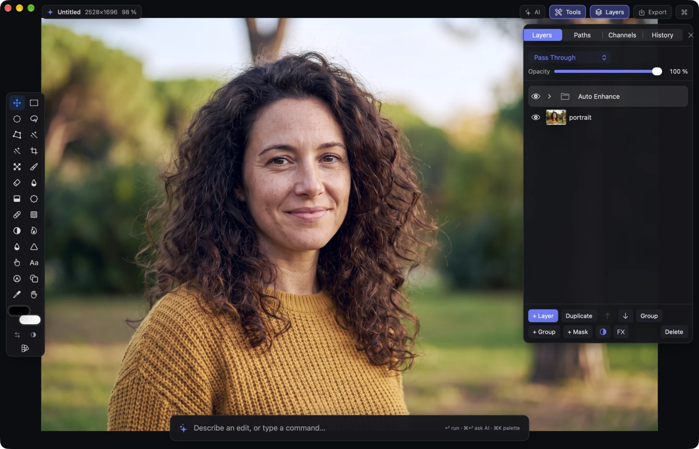

# On-device intelligence

Many of Glimmer's smart tools run entirely on your Mac. They use Apple's Vision and Core Image frameworks and a few Core ML models. They are free, they work without an OpenRouter key, and your image never leaves the computer. Most of them work offline. The exception is the first time you use a tool that needs a downloaded model (see [Models you download](#models-you-download)).

You find these tools in the regular menus and in the **On This Mac** section of the AI panel. Each button there has a tooltip that ends with "Runs on this Mac, free."

The one-click corrections need an image to work on. On a new, empty document they are dimmed.

## Automatic corrections

### Auto Enhance

Choose **Image › Auto Enhance** (⇧⌘L). Glimmer analyzes the image with Core Image's automatic adjustments and adds the result as a group named **Auto Enhance** at the top of the layer stack. The group can hold up to three adjustment layers:

- **Curves**, for tone: brightness, contrast, and a lift in the shadows or a softer top end where the image needs it.
- **Color Balance**, only when the image has a clear color cast.
- **Vibrance**, when the colors are flat or overdone.

Nothing is baked into your pixels. Open the group to fine-tune any of the layers, lower the group's opacity to soften the whole correction, hide it to compare, or delete it.

If the image already looks balanced, Glimmer adds nothing and tells you so.

### Auto Color

Choose **Image › Auto Color** (⇧⌘B) to remove a color cast, such as the yellow of indoor light or the blue of shade. Glimmer measures the near-neutral pixels in the image and ignores strongly colored areas, so a red car or a blue sky doesn't count as a cast. It then adds one **Color Balance** layer named **Auto Color** at the top of the stack, with Preserve Luminosity on. The correction removes most of the cast but not all of it, because a little warmth or coolness is often intended.

Auto Enhance only corrects a clear cast. Use Auto Color for subtler ones. If there is no cast worth correcting, Glimmer tells you and adds nothing.

### Auto Straighten

Choose **Image › Auto Straighten** to level a tilted horizon. Glimmer looks for a horizon tilted between 0.4° and 20°. A steeper line is more likely a diagonal in the scene than a crooked camera, so Glimmer leaves it alone.

When it finds one, Glimmer switches to the Crop tool with the crop box already rotated to level the horizon. Check the result, adjust the box if you like, and apply the crop as usual. If there is no tilted horizon, Glimmer tells you.

### Suggest Crop

Choose **Image › Suggest Crop** to let Glimmer frame the image for you. It switches to the Crop tool and places the crop box:

- When the image has faces, the box frames the people: heads and shoulders, with the faces near the upper third.
- Otherwise it finds the most eye-catching part of the image and frames it with some room around it, nudged towards the nearest third line.

The box keeps the aspect ratio set in the Crop tool's options. Without a fixed ratio, it keeps the image's own proportions and never shrinks below about 55 % of the frame. Adjust the box and apply the crop as usual. If the whole image already frames the subject well, Glimmer tells you.

## Smart selections

All of these replace the current selection. Use **Select › Deselect** (⌘D) or Undo (⌘Z) to go back.

### Select Subject

Choose **Select › Subject** to select the main subject of the whole image. Glimmer uses Vision's subject detection on the visible image.

### Select People

Choose **Select › People** to select every person in the image. This uses Vision's person segmentation, which gives finer edges around hair and clothing than Select Subject. If nobody is found, Glimmer tells you.

### Select Sky

Choose **Select › Sky** to select the sky. Glimmer first estimates depth to find the far, smooth region that reaches the top edge of the image. It then hands that region to Segment Anything, which draws the exact outline around ridges, cables and branches. If the top of the image isn't sky, Glimmer tells you.

Select Sky needs both downloaded models: the depth model and Segment Anything.

### Magic Select

The Magic Select tool (A) selects whatever object you click, using Segment Anything (SAM 2.1 Tiny).

1. Choose the Magic Select tool, or click **Magic Select Tool (A)** in the AI panel's **On This Mac** section.
2. Click the object. Glimmer selects it.
3. Click more places on the object to add to the selection. ⌥-click a place to exclude it.
4. Press Return, or click **Apply** in the tool options bar, to keep the selection. Press Esc, or click **Clear Points**, to drop the points and get back the selection you had before.

The tool options bar shows how many points you have placed. Later clicks refine earlier ones. Only the 14 most recent points count.

The first click on an image takes a moment while Segment Anything reads the image. Further clicks on the same image are fast.

### Remove Background

Choose **AI › Remove Background**, or click **Remove Background** in the **On This Mac** section. Glimmer finds the subject of the active layer and adds a layer mask that hides everything else. Your pixels are not deleted. Paint on the mask to fix the edges, or turn the mask off to get the background back.

The active layer must be a pixel layer or a smart object. Remove Background doesn't work on adjustment layers or groups.

## Lens Blur with depth

**AI › Lens Blur…** opens the **Lens Blur** section of the AI panel. This blur estimates how far away each part of the image is and blurs what's out of focus, like a wide-aperture lens. It is different from **Filter › Blur › Lens Blur…**, which blurs everything evenly.

1. Set the sliders, then click **Preview Lens Blur**. The first time, Glimmer estimates depth for the image. After that, the blur shows on the canvas.
2. Adjust the sliders. The preview updates as you drag.
   - **Focus distance**: which part stays sharp. The value reads Near, Middle or Far.
   - **Focus range**: how deep the sharp zone is, from 0 to 60 %.
   - **Blur**: how strong the blur is.
   - **Bokeh**: how much bright spots bloom into discs.
3. Turn on **Show depth map** to see what Glimmer estimated. White is near and black is far. Turn it off to see the blur again.
4. Click **Apply** (Return) to keep the blur, or **Cancel** (Esc) to throw it away.

Apply adds the blurred image as a new layer named **Lens Blur**, in one undo step. The layers underneath stay as they were.

Glimmer remembers the depth map for the image. As long as you don't change the image, the next preview starts right away.

## Text in the image

Glimmer reads the text in the visible image on your Mac, line by line. It detects the language by itself.

### Copy Text in Image

Choose **Edit › Copy Text in Image**. Glimmer copies all the text it can read to the clipboard as plain text, one line per line, and tells you how many lines it copied.

### Image Text to Layers

Choose **Layer › Image Text to Layers** to turn the text in the image into editable text layers. Each line becomes its own text layer, placed over the original, sized to cover it and colored like it. All the new layers go in a group named **Text from Image** at the top of the stack.

The original text is still in the pixels underneath. To replace the text, paint out or remove the original, then edit the text layers.

## Straighten Document

Choose **Image › Straighten Document** when you have photographed a document, receipt, sign, whiteboard or screen at an angle. Glimmer finds its four corners and flattens it into a straight-on rectangle. The result opens as a new document with one layer named **Straightened**. Your original document is not changed.

If Glimmer can't find a clear document, sign or screen covering a fair part of the frame, it tells you.

## Upscaling with Real-ESRGAN

**AI › Upscale…** opens the **Upscale** section of the AI panel.

1. Choose **Scale**: 2× or 4×.
2. Choose **Method**:
   - **Real-ESRGAN (on this Mac)**: a neural network that adds plausible detail and sharp edges. It runs on your Mac. The model is built into the app, so there is nothing to download.
   - **Lanczos**: classic high-quality resampling on the GPU. Fast, but it adds no detail.
3. Click **Upscale**.

The panel shows the result size. The upscaled image opens as a new document. Your original is not changed.

Real-ESRGAN works up to 16,384 pixels on the long side of the result. For larger results, choose 2× or Lanczos.

The **Add AI detail** option sends the result to OpenRouter for an extra detail pass. That part costs money. See [AI with OpenRouter](11-ai-with-openrouter.md). Without it, upscaling is free.

## Layer names from content

When you place or paste an image into a document that already has content, the new layer gets the file's name or a name like "Pasted Layer". If that name says nothing about the picture (camera names like IMG_1234 or DSC_0042, "Screenshot …", "Pasted Layer", or names that are mostly digits), Glimmer looks at the image and renames the layer after what it shows, such as "Mug" or "Rocks & Bridge".

Renaming happens on your Mac, a moment after the layer appears. It is not an undo step. Glimmer only replaces a name nobody chose: if you rename the layer first, your name stays. If Glimmer isn't confident about what the image shows, the layer keeps its original name.

## Suggestions for the open image

When you click in the omnibar at the bottom of the canvas, Glimmer analyzes the open image on your Mac and shows up to four suggestions for it, marked with a wand. They depend on what it finds:

| Glimmer finds | It suggests |
|---|---|
| A tilted horizon | **Straighten**, with the angle, for example "Straighten 2.3°" |
| A flat, dark, bright or muted image | **Auto Enhance** |
| A color cast, when Auto Enhance isn't needed | **Auto Color** |
| Faces | **People** (Select People) and **Lens Blur…** |
| Readable text | **Image Text to Layers** |
| A better framing | **Suggest Crop** |

Click a suggestion to run it. Analysing the image is free and private. The general ideas next to the suggestions go to the assistant instead. See [The assistant and the command palette](12-assistant-and-command-palette.md).

## Simple requests with Apple Intelligence

When Apple Intelligence is available on your Mac, Glimmer uses Apple's on-device language model to understand short requests before it sends anything to OpenRouter. This applies to everything you send to the assistant: from the omnibar, from the command palette, and from the chat in the AI panel.

- If one command does exactly what you asked, Glimmer runs it on your Mac. For example, "invert", "flip horizontal", "black and white" or "new layer". The assistant replies "Done: …" and notes that it ran on this Mac with no AI cost. A general request such as "fix the colors" or "make it look better" runs Auto Enhance.
- If you ask for a brand-new picture, such as "a cat astronaut", Glimmer generates it as a new layer. Generating uses OpenRouter and costs money, and it needs your key.
- Everything else goes to the assistant's planner on OpenRouter: requests with several steps, specific amounts ("brighten it by 20 %"), changes to the photo's content ("remove the person"), and questions.

A request that names more than one thing never runs as a single command. Glimmer treats commas and words like "with", "then" and "and" as joining two requests ("black and white" counts as one name), and so are requests longer than eight words. Commands that open a dialog, and commands from the File and View menus, are never picked this way.

To turn this off, open **Glimmer › Settings › General** and, under **Assistant**, turn off **Understand simple requests on this Mac**. The setting is on by default. It is dimmed when your Mac doesn't have Apple Intelligence.

## Models you download

Two features need models that are not built into the app. These are Apple's Core ML conversions on Hugging Face, under the Apache 2.0 license. After the download they run on your Mac like the rest.

| Model | Size | Used by |
|---|---|---|
| Depth (Depth Anything V2 Small) | about 50 MB | Lens Blur, Select Sky |
| Magic Select (SAM 2.1 Tiny) | about 80 MB | Magic Select, Select Sky |

Glimmer never downloads a model by itself. The first time you use a feature that needs one, Glimmer asks first: a sheet shows the size, who publishes the model, a link to its source and its license. Nothing is fetched until you click **Download**. Click **Cancel**, and nothing happens. You can also download the models ahead of time in **Glimmer › Settings › Models**.

Glimmer fetches each model at a fixed version, and checks every file against the checksum the source publishes for it before it installs the model. If a file doesn't match, Glimmer installs nothing, keeps nothing of the download, and says so. The download needs an internet connection. Glimmer then compiles each model for your Mac and keeps it in its Application Support folder, under `Glimmer/Models`. Because Glimmer is sandboxed, that folder is inside the app's container in your Library.

To see which models are installed, open **Glimmer › Settings › Models**. Each model shows **Downloaded** or **Not downloaded**, its size, publisher, source and license. Click **Remove** to delete a downloaded model, and **Download…** to get it again.

An agent that uses Glimmer's local API can't download a model. A step that needs a missing model is refused with `model_missing`, and the agent can open **Settings › Models** for you to decide.

Real-ESRGAN is built into the app and is not listed there.
