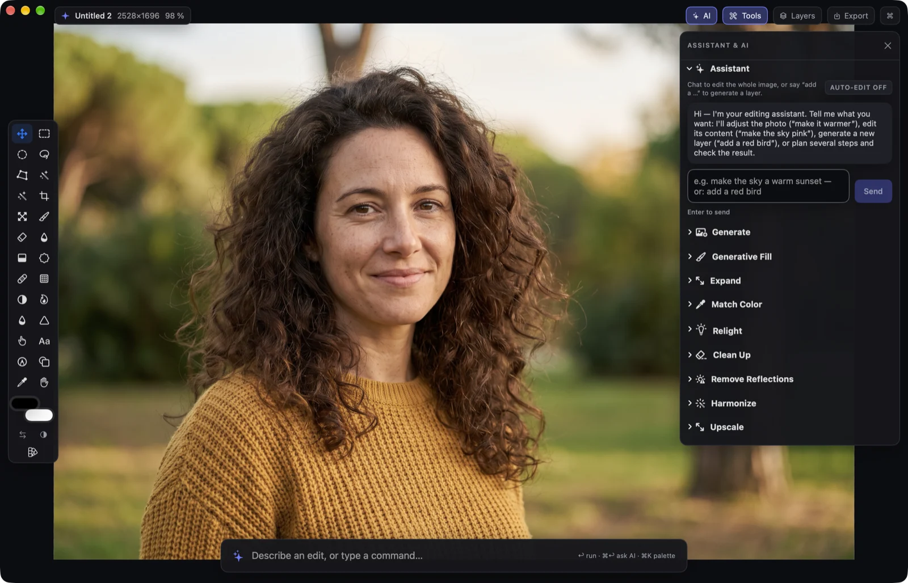

# AI with OpenRouter

Glimmer's generative tools, such as Generate, Generative Fill and Expand, use AI models in the cloud. Glimmer reaches them through OpenRouter, a service that gives access to many AI models with one account. You use your own OpenRouter key and pay OpenRouter directly for what you use. Glimmer has no account, subscription or server of its own in between.

Everything in [On-device intelligence](10-on-device-intelligence.md) works without a key and costs nothing.

## Your OpenRouter key

1. Create a key at [openrouter.ai/keys](https://openrouter.ai/keys).
2. Open **Glimmer › Settings › AI**.
3. Paste the key into **API key** and click **Save**.
4. Click **Test Key** to check it. Glimmer shows **Valid**, and if the key has a spending limit, how much is left.

Glimmer stores the key in your keychain. It only sends the key to openrouter.ai. To stop using it, click **Remove**.

Until you add a key, the AI panel shows a banner, **Add your OpenRouter key**, with a button that opens Settings.

### Models

Under **Models** in the same tab you choose which OpenRouter models Glimmer calls:

- **Image model** makes and edits pictures. The default is `google/gemini-3-pro-image-preview`.
- **Text model** plans the assistant's edits, checks results, suggests edits and finds distractions. The default is `google/gemini-2.5-flash`.

Type any OpenRouter model id to use another model. **Restore Defaults** puts both back.

## Other services for text

The Assistant, its suggestions and Find Distractions send text (and a small picture of your document) to a language model. By default that is OpenRouter too. In **Glimmer › Settings › AI**, under **Text (the Assistant)**, you can choose another service for it. Pictures are still made through OpenRouter.

<!-- providers:begin (generated from the app's list of services by scripts/export-agents-guide.sh; don't edit by hand) -->
| Service | Used for | Key | Where your data is processed | Notes |
|---|---|---|---|---|
| OpenRouter | text (the Assistant), images | your own, in **Settings › AI** | see the service's terms |  |
| Berget | text (the Assistant) | your own, in **Settings › AI** | Stockholm, Sweden | Built from Berget's documentation; not yet tried with a real call. Berget AI runs open models in Stockholm. Its terms say it never stores the content of prompts or answers. |
| Grunden | text (the Assistant) | your own, in **Settings › AI** | Sweden | Built from Grunden's documentation; not yet tried with a real call. Grunden AI runs open models in Sweden and says all processing happens there. |
<!-- providers:end -->

For a service other than OpenRouter:

1. Choose it under **Service**.
2. Paste your key from that service and click **Save**. Each service has its own key, stored in your keychain and sent only to that service.
3. Choose a **Model**. The list comes from the service itself each time, so it only offers models the service has now. If a model you chose earlier is gone, Glimmer says so.

Under the model, Glimmer shows what the service's own list says: its price per million tokens when the list has prices (otherwise "Billed by … at their rates"), and two warnings when they apply. A model without tool calls can't be used by the Assistant, which works by calling Glimmer's tools. A model that can't take pictures makes the Assistant plan without looking at the document, and suggestions and Find Distractions won't work with it.

The first time a request is about to go to a service, Glimmer tells you which service it is, what is sent (what you typed, the list of Glimmer's operations, a description of your document and, when the model takes pictures, a small picture of it), where the service says it processes it, and that it is billed to your key. Choose **Send** or **Not Now**. You can read the same text again under **What is sent to …** in the settings. Glimmer asks once per service, not for every request.

Suggest Edits and Find Distractions need a model that can look at pictures. With a model that can't, Glimmer doesn't send the request and says why, with a button to the settings.

Berget and Grunden are Swedish services that run open models in Sweden. Glimmer's support for them is built from their documentation and has not been tried with a real call yet. If a service answers with an error, Glimmer shows the error as it came, with its status code.

## What costs money

A feature costs money when it sends a request to OpenRouter. The price depends on the model you have chosen and on OpenRouter's pricing. OpenRouter bills it to your account.

| Costs money (OpenRouter) | Free (on this Mac) |
|---|---|
| Generate | Match Color |
| Edit Image with Prompt | Presets |
| Generative Fill and Remove Object | Lens Blur |
| Expand | Upscale with Real-ESRGAN or Lanczos |
| Relight | Everything in the On This Mac section |
| Remove Reflections | Opening the AI panel, browsing, settings |
| Harmonize | |
| Upscale with **Add AI detail** | |
| Find Distractions | |
| The assistant's planning, quality check and Suggest Edits | |

Requests that the assistant handles on your Mac with Apple Intelligence cost nothing. See [The assistant and the command palette](12-assistant-and-command-palette.md).

## The AI panel

The AI panel is a tab in the inspector. Each section opens when you choose its command in the **AI** menu, and you can also open and close sections by clicking their titles.

Every result lands as a new layer, a new document, a mask or a selection. Glimmer never paints over your original pixels, and each result is one undo step.

Images sent to the image model are scaled down to at most 2,048 pixels on the long side. Glimmer scales the answer back to fit your document.

### Generate

**AI › Generate Image…** creates a picture from a description.

- Type a description, for example "A lighthouse at dusk, film photo".
- **Avoid (optional)**: things you don't want in the picture.
- **Size**: **Document** (the size of your canvas), **Square** (1024 × 1024), **Portrait** (832 × 1216) or **Landscape** (1216 × 832). Glimmer asks the model for this size.

Click **Generate Layer**. The picture lands as a new layer named **Generated**, centered and scaled down to fit inside the document if it is larger.

### Edit Image with Prompt

**AI › Edit Image with Prompt…** opens the Assistant section. Describe a change to the content of the photo, such as "make it snowy" or "change the car to red". The assistant plans an AI edit step for it. That step sends the whole visible image to the image model and adds the edited version as a new layer named **Edited**, at the size of your document.

### Generative Fill and Remove Object

**AI › Generative Fill…** works on the current selection. Make a selection first, for example with the marquee (M) or **Select › Subject**.

Choose a **Mode**:

- **Fill** replaces the selected area. Describe what should appear there, or leave the field empty to make the area blend in with its surroundings. Click **Reference Image…** to pick a picture of an object to insert. Glimmer then asks the model to put that object into the selection, adapted to the scene's scale, perspective and light. Click the clear button next to the file name to drop the reference.
- **Remove** erases what's in the selection and rebuilds the background behind it. You can describe what to remove or what should be behind it, but you don't have to.

Click **Fill Selection** or **Remove Object**.

Glimmer sends the selected area plus some surrounding context. It matches the colors of the result to the untouched pixels around it and softens the edge. The new layer, **Generative Fill** or **Removed**, only shows the selected area.

**AI › Remove Object** runs Remove right away on the current selection, without the panel.

When you have a selection, the action bar next to it offers the same two things: type in **Describe what to add here…** and click **Generate** to fill, or click **Remove** with the field empty.

### Expand

**AI › Expand…** makes the canvas bigger and fills the new area with a continuation of the scene.

- **Grow**: **Evenly** adds the same margin on all sides, at **125 %**, **150 %** or **200 %** of the current size. **Per Side** lets you type the number of pixels to add at the top, bottom, left and right.
- **What's beyond the edges? (optional)**: describe what the new area should show.

The panel shows the new size. Click **Expand Canvas**. Glimmer grows the canvas, moves all your layers to keep their place, and adds the expanded image as a new layer named **Expanded** on top. The original area is kept as it was.

### Match Color

**AI › Match Color…** gives the active layer the color grade of a reference image. It runs on your Mac and costs nothing.

1. Select a pixel layer or a smart object.
2. Set **Strength**.
3. Click **Choose Reference…** and pick an image, or drop an image on the section.

The result is a new layer named after the original with "(matched)" added.

### Relight

**AI › Relight…** changes the lighting of the whole visible image while keeping its content.

- **Light from**: Left, Right, Top, Bottom, Front or Behind.
- **Light color**: warm colors give golden light, blue colors give daylight.
- **Intensity**: low values give a subtle change, high values dramatic, high-contrast light.
- **Environment (optional)**: describe a setting to light the scene for, for example "a neon-lit street".

Click **Relight**. The result is a new layer, for example **Relit (left)**.

### Clean Up and Find Distractions

**AI › Find Distractions…** opens the **Clean Up** section. Click **Find Distractions**. The text model looks at the image and lists things a retoucher would usually remove: photobombers, litter, signs, cables and dust spots, among others.

Each item shows a colored dot for how distracting it is (red high, orange medium, yellow low), a short label and the reason. For each one you can:

- **Select** it, to refine the selection or use another tool.
- **Remove** it. This runs Remove Object on its area.
- Dismiss it with the × button.

**Remove All** removes every listed item in one go. Finding distractions is one request to the text model. Each Remove, and Remove All, is one request to the image model.

### Remove Reflections

**AI › Remove Reflections…** removes glare and reflections from glass, water and screens. If you have a selection, Glimmer works inside it. Otherwise it works on the whole image.

Set **Strength**: low values only knock back the strongest hotspots, high values remove reflections completely. Click **Remove Reflections**. The result is a new layer named **Reflections Removed**.

### Harmonize

**AI › Harmonize Layer…** helps a pasted-in subject sit naturally in the scene below it. Select the pasted layer, set **Strength** and click **Harmonize Layer**. Glimmer relights and color-grades the layer to match its surroundings and can add a soft contact shadow.

The result is a new layer named after the original with "(harmonized)" added. Glimmer hides the original layer, so you can switch back. The result keeps the original layer's shape.

### Upscale

**AI › Upscale…** opens the Upscale section. Upscaling with Real-ESRGAN or Lanczos runs on your Mac and is free. See [Upscaling with Real-ESRGAN](10-on-device-intelligence.md#upscaling-with-real-esrgan).

Turn on **Add AI detail** for an extra pass with the image model after the upscale. Set **Creativity**: low values only sharpen edges and textures, high values add more fine detail. Glimmer splits the image into tiles of 1,024 pixels and sends each tile as a separate request, so the cost grows with the size of the result. The panel shows how many tiles it will send, in orange when there are more than 16. **Add AI detail** works for results up to 8,192 pixels on the long side.

The result opens as a new document.

### Presets

**AI › Presets…** shows Glimmer's ten photo looks, from Cinematic Teal & Orange to Dreamy Soft. Hover over a preset to read what it does, and click it to apply it. Presets run on your Mac and cost nothing.

A preset adds a group of adjustment layers above the active layer. Some presets also include filters such as grain, clarity or a vignette. Those are applied to the active pixel layer. If the active layer isn't a pixel layer, Glimmer applies the adjustments and tells you to select a pixel layer and apply the preset again to include the filters.

## Activity: the jobs list

The bottom of the AI panel shows **Activity**, a list of the jobs in this window, newest first. On-device jobs such as Remove Background and Lens Blur appear there too.

- A running job shows a spinner and a stop button. Click the stop button to cancel the job. Nothing is added to your document.
- A finished job shows a green check. A failed job shows a warning sign and the reason. A cancelled job shows a cross.
- A job that cost money shows its cost in US dollars, as OpenRouter reported it.
- The heading shows the total cost of this window's jobs.
- **Clear** removes finished, failed and cancelled jobs from the list.

The list keeps the 30 most recent jobs.

The assistant's planning, its quality check and Suggest Edits also call the text model and are billed by OpenRouter, but they are not listed in Activity.

## Result cache

Glimmer keeps every image the image model returns in a cache folder on your Mac. If an edit sends exactly the same request again (the same model, the same instructions and the same input images), Glimmer uses the saved result instead of calling OpenRouter. That costs nothing, and Activity shows no cost for it.

Generate is the exception: every run starts from a new random seed, so running it again with the same description gives you a new picture.

The cache is in the app's Caches folder, in a folder named `AIResults`. Text-model requests, such as Find Distractions or the assistant, are not cached.
