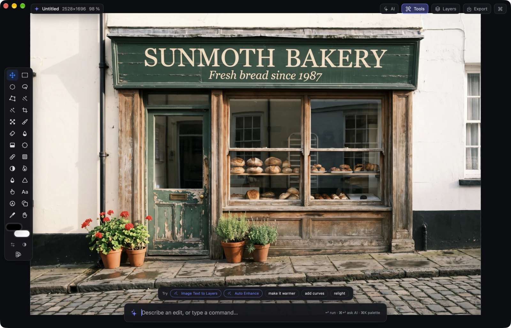

# The assistant and the command palette

You can run almost anything in Glimmer by typing. The omnibar on the canvas and the command palette (⌘K) find commands, tools, filters, adjustments, presets and your saved actions. When what you type reads like a request ("make it warmer and add a vignette"), they hand it to the assistant, which plans the edit and carries it out with Glimmer's own tools.

## The omnibar

The omnibar is the search bar at the bottom of the canvas. Click it, or click into **Describe an edit, or type a command…**, and start typing. Up to five matches appear above it.

- ↩ runs the highlighted row. That is the best match, unless the text reads like a request, in which case the top row asks the assistant.
- ⌘↩ always sends the text to the assistant.
- ↑ and ↓ move between rows. Esc clears the omnibar and gives the keyboard back to the canvas.

When you click into the empty omnibar, a row of suggestion chips appears.

- Chips with a wand are suggestions for this image, such as "Straighten 2.3°" or **Auto Enhance**. Glimmer finds them by analysing the image on your Mac, and clicking one runs the command. See [Suggestions for the open image](10-on-device-intelligence.md#suggestions-for-the-open-image).
- The other chips are general ideas: "make it warmer", "add curves", "relight", "remove background", "vintage look". Clicking one sends it to the assistant.
- On a new, empty document the chips are ideas for pictures to generate instead, such as "a sunset over mountains". Clicking one asks the assistant to generate it.

The omnibar hides while you crop, transform or use Liquify, and while the command palette is open. To hide it for good, turn off **Show the search bar on the canvas** in **Glimmer › Settings › General**.

## The command palette

Press ⌘K, or choose **View › Command Palette…**, to open the command palette. Type to search, use ↑ and ↓ to pick a row, press Enter to run it, or press Esc to close the palette.

The palette searches:

- every menu command, filter and adjustment,
- every tool (the row shows the tool's key),
- Glimmer's presets,
- your saved actions.

Each row shows its category on the left and its shortcut, if it has one, on the right. If a command can't run right now, for example because it needs a selection, Glimmer beeps.

### How search works

The search is fuzzy. The letters you type must appear in order, but not next to each other, so "gblur" finds Gaussian Blur. Matches at the start of a word and unbroken runs of letters rank higher. A match in the title counts more than a match in the category or in the command's keywords. The keywords let you find commands by other words: "white balance" finds Auto Color, and "outpaint" finds Expand.

When Glimmer runs in Swedish, the Swedish titles are searchable too, alongside the English ones. Typing "webben" finds Export for Web….

### Recents and frequently used items

With nothing typed, the palette lists the six items you used most recently.

Glimmer also counts how often you run each item from the palette or the omnibar. Items you use often rank a little higher in the results. The boost fades when you stop using an item: it halves every two weeks. It breaks ties between similar matches but doesn't push a clearly better match down.

### Asking the assistant from the palette

The palette always offers a row **Ask the assistant: "…"** with your text. It is at the bottom of the list, or at the top when your text reads like a request: four or more words, or two or more words without a convincing command match. Choosing it opens the AI panel and sends the text to the assistant.

## The assistant

The assistant is the top section of the AI panel. Open it with **AI › Assistant** (⇧⌘K).

Type what you want in the field and press Enter, or click **Send** (⌘↩). You can ask it to:

- adjust the photo ("make it warmer", "more contrast in the shadows"),
- edit the content ("make the sky pink"),
- add a generated layer ("add a red bird"),
- combine several steps ("black and white with a vignette and a title at the top").

The assistant uses the text model you chose in **Settings › AI**. It needs a key for the text service (OpenRouter unless you chose another; none for a model in Ollama on your Mac), and each request to a service costs money. See [AI with OpenRouter](11-ai-with-openrouter.md). Simple one-command requests can run on your Mac for free first, with Apple Intelligence. See [Simple requests with Apple Intelligence](10-on-device-intelligence.md#simple-requests-with-apple-intelligence).

The assistant remembers the last few turns of the conversation, so you can follow up with "a bit less" or "now add a title".

### Plans and steps

The assistant answers with a short message and a plan: a checklist of steps, each with a one-line reason. As the plan runs, each step shows its status: waiting, running, done, failed or skipped. If a step fails, its error appears under it and the remaining steps are skipped.

What happens next depends on the plan:

- A plan that only uses the editor's own tools, such as adjustment layers, filters, presets, text and selections, runs straight away, as long as it does what you asked. If a step that would change the document isn't named by anything in your request, the plan is shown and waits for **Run** instead, and the reply says so. This happens, for example, if you write something that isn't a request to edit at all. When Glimmer can't tell, it waits.
- One case is handled more gently. If the only thing you didn't ask for is **Auto Enhance** or **Auto Color** beside what you did ask for, Glimmer runs what you asked for straight away and shows the extra as an offer of its own: "The assistant also suggests Auto Enhance, which you didn't ask for." Click **Run** to apply it to the picture as it is then, or **Dismiss**.
- If a step came without saying which adjustment or filter it means, and your own words can mean only one (as in "make it black and white"), Glimmer fills it in and the step says **type taken from your request**. If your words fit more than one, such as "brighter", nothing is guessed and the step fails.
- A single command picked on your Mac for a short request works the same way: if your words don't name it, the assistant says which command it thinks you mean and waits for **Run**.
- A plan with steps that go to the picture service (OpenRouter unless you chose another) shows **Uses AI credits** and waits. Those steps are AI edits of the whole image, generated layers, and Generative Fill or Remove on a selection. Steps that run on your Mac, such as Select Subject, Remove Background and upscaling, never make a plan wait. Click **Run** to carry it out, or **Dismiss** to drop it. While it runs, click **Stop** to cancel it.
- Such a plan also shows **Price not known in advance**. Until you have ticked, once for the picture service, that it states no price in advance, **Run** is gray and the tick box stands under the plan. See [What costs money](11-ai-with-openrouter.md#what-costs-money).

The whole plan is one undo step, named after your request, such as "Assistant: make it warmer". Press ⌘Z once to undo all of it.

If the model proposes a step the editor can't do, the assistant drops it and names it in its reply.

If your request is unclear, the assistant may ask a question instead of making a plan.

### Auto-edit

The **AUTO-EDIT** button in the Assistant section's header switches between **AUTO-EDIT OFF** and **AUTO-EDIT ON**. When it is on, plans with AI jobs also run straight away without waiting for **Run**. The same setting is **Run AI steps without asking** in **Glimmer › Settings › General**. It is off by default. With it on, a plan with AI jobs still waits until you have made the once-per-service tick that the price is not known in advance.

### The quality check

After a plan has finished without errors, the assistant compares a picture of the document before and after with your request. If the result looks right, nothing more happens. If not, it adds a follow-up message with up to three corrective steps and runs them. Corrections only use the editor's own tools, never paid AI jobs, and they land in the same undo step as the plan.

The quality check is one more request to the text model. To turn it off, turn off **Check the result and adjust once** in **Glimmer › Settings › General**.

### What the assistant sees

By default, every request includes a small copy of the image, at most 1,024 pixels on the long side, so the assistant can choose settings that suit the photo. It also knows the canvas size, the number of layers, the active layer and whether there is a selection. To send only the text, turn off **Let the assistant see the image** in **Glimmer › Settings › General**.

### Numbers in the assistant's answers

A language model can state a number that sounds right and is made up. So Glimmer checks the assistant's text before you see it: a sentence with a number that Glimmer didn't give the model, that you didn't write yourself and that isn't in the plan's own steps is left out, and the answer ends with **Glimmer left out a figure it could not verify.** Prices are treated the same way: what a request costs is shown by Glimmer from the service's own answer, never by the assistant. If you ask how big the document is and the model gets it wrong, Glimmer writes the size and layer count itself.

A number counts as given, and stays, when it is:

- in what you wrote, or in what Glimmer told the model about the document (its size, its layer count, the active layer's name);
- something Glimmer itself works out from the document's size before it reads the answer: half, double and four times each side; the other side when you name an aspect ratio (2400 × 1350 for 16:9 of a 2400 × 1600 image); the megapixels; the size as a ratio in lowest terms (3:2); and a percentage you name, of each side;
- in the description of an operation, but only in a sentence that names that operation or what it does ("I can upscale it 2× or 4×");
- 0, 1 or a number up to the count of the plan's steps, as in "2 steps" or a numbered list.

So the assistant may do the sum, and a correct one stays. What it says about your own document is held to the document: "a 4:3 image" for an image that is 3:2 is left out. And whatever the arithmetic, a sentence about money, how long something takes, a file's size on disk, quality or a service keeps a figure only if you or Glimmer gave it.

The check sees numbers, not claims. If the assistant says that something is free, that is the model talking; the price is the one your service lists.

### Suggest Edits

When a text service is set up, the Assistant section has a **Suggest Edits** button. The assistant looks at the image and proposes three different edits for this photo, for example one correction, one mood and one bold change, in the language the app runs in. Click a suggestion to send it as a request. Suggest Edits is one request to the text model.

### Saving a plan as an action

When a plan has finished, click **Save as Action** under it. Glimmer keeps the steps, together with any corrections from the quality check, as an action named after your request. Saving a new action with the same name replaces the old one.

Saved actions run again without asking the assistant, so there is no planning cost. Steps in the action that call OpenRouter, such as an AI edit or a generated layer, still cost money each time.

To run a saved action:

- In the Assistant section, click **Actions** and choose it.
- Press ⌘K and type its name. Actions show the category **Action**.
- From Shortcuts or Batch Process. See [Automation](13-automation.md).

Running an action is one undo step, named after the action. To delete an action, choose **Actions › Delete** and pick it.

### What the assistant can and can't do

The assistant works through a fixed set of steps. It can:

- add adjustment layers with specific settings,
- apply filters to a pixel layer, inside the selection if there is one,
- add layer styles such as a drop shadow, stroke or glow,
- apply presets,
- add a text layer at the top, center or bottom, and give single words their own font, boldness, size or color,
- move, scale, rotate, skew or distort a layer or a group, like Free Transform,
- crop the image to a shape such as 16:9 or to the selection, add room around it, and resize the whole image,
- change a layer's opacity, blend mode, visibility or name,
- run Auto Enhance and Auto Color,
- select the subject, people, the sky, a rectangle, an ellipse or everything, invert and feather the selection, and deselect,
- remove the background,
- fill the selection with a color, set the foreground color, add an empty layer and choose which layer to work on,
- run many commands from the Image, Layer, Select and View menus,
- edit the whole image with an instruction, generate a new layer, fill or remove the selection, and upscale. These are paid AI jobs, except upscaling, which uses Real-ESRGAN on your Mac.

It can't:

- paint, retouch or draw with the brushes,
- straighten with the Crop tool or use Liquify,
- add an image from a file as a new layer (use **File › Place Image…**),
- open, save or export files,
- open dialogs such as Layer Style or the fill layer dialogs,
- change Glimmer's settings.
