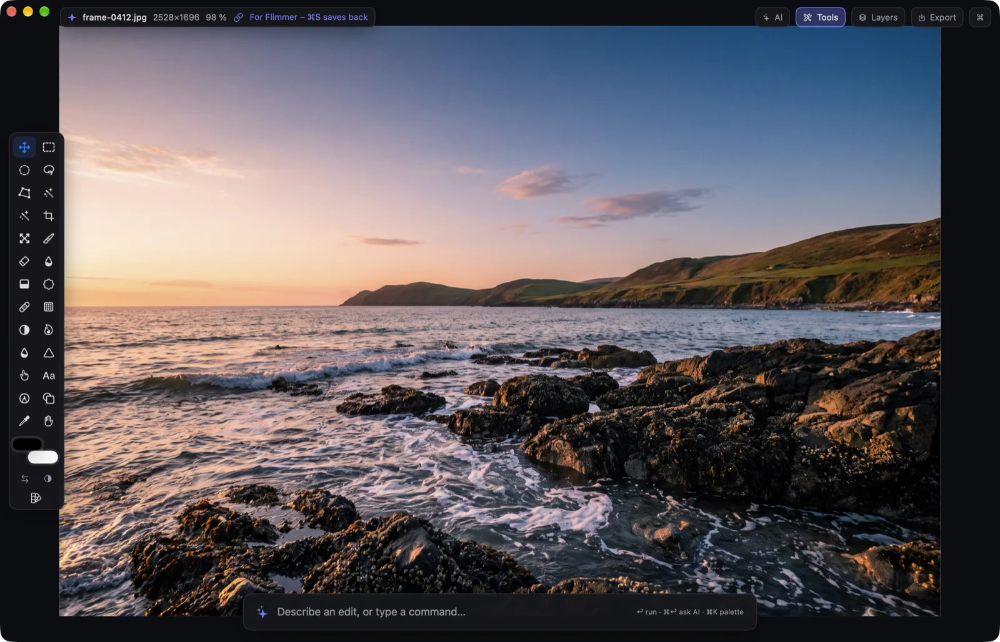
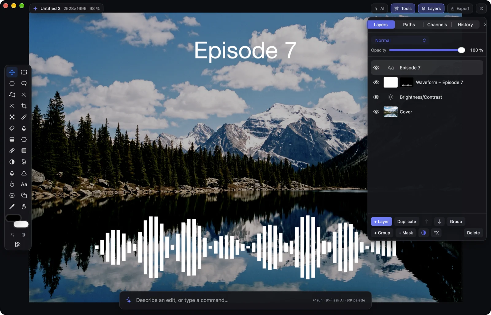

# Automation

Glimmer can edit images without you clicking through each one. You can use its actions in the Shortcuts app and with Siri, replay a saved assistant action on many photos, run a batch over a folder, or let an AI agent on your Mac drive the app through a local API.

## Shortcuts and Siri

Glimmer adds six actions to the Shortcuts app. They all run in the background: no Glimmer window opens. Each one takes an image file and returns a new image file, so you can chain them with other actions, for example to repeat one over every file in a folder. Your original file is not changed.

Where an action has a **Format** parameter, you can choose PNG, JPEG, HEIC, TIFF or WebP.

### Auto Enhance Image

Corrects tone and color on your Mac, like **Image › Auto Enhance**.

- **Image**: the photo to correct.
- **Format**: the output format. JPEG by default.

If the image needs nothing, you get it back unchanged in the chosen format.

Siri phrases: "Auto enhance a photo with Glimmer", "Fix a photo with Glimmer".

### Remove Background

Cuts the main subject out of an image on your Mac and returns a PNG with a transparent background. The file name gets " cutout" added.

- **Image**: the photo to cut out.

Siri phrases: "Remove the background with Glimmer", "Cut out an image with Glimmer".

### Apply Glimmer Preset

Applies one of Glimmer's photo looks to an image. The file name gets the preset's name added.

- **Image**: the photo.
- **Preset**: one of Glimmer's presets.
- **Format**: JPEG by default.

Siri phrases: "Apply a Glimmer preset", "Apply *preset* in Glimmer", for example "Apply Golden Hour in Glimmer".

### Apply Glimmer Filter

Runs one filter, with its default settings, on an image.

- **Image**: the photo.
- **Filter**: Gaussian Blur, Lens Blur, Motion Blur, Sharpen, Unsharp Mask, Clarity, Add Noise, Pixelate, Find Edges, Emboss, Oil Paint, Halftone, Vignette or Chromatic Aberration. Vignette by default.
- **Format**: JPEG by default.

Siri phrase: "Apply a Glimmer filter".

### Run Glimmer Action

Runs an action you saved from the assistant on an image. See [Saving a plan as an action](12-assistant-and-command-palette.md#saving-a-plan-as-an-action).

- **Image**: the photo.
- **Action**: one of your saved actions.
- **Format**: JPEG by default.

Siri phrase: "Run a Glimmer action".

### Export Glimmer Document

Flattens a Glimmer document, or converts an image, to another format.

- **Document**: a `.glimmer` document or an image.
- **Format**: PNG by default.

Siri phrase: "Export with Glimmer".

## Saved actions without the window

When you save a plan as an action, you can run it in the editor, from Shortcuts with **Run Glimmer Action**, and in Batch Process. Outside the editor there is no window, no selection and no OpenRouter call, so only some steps can run.

These steps run in Shortcuts and in a batch:

- adjustment layers,
- filters, applied to the topmost visible pixel layer,
- presets,
- layer styles, applied to the topmost visible pixel layer,
- text layers (black, unless the step sets a color),
- Auto Enhance and Auto Color,
- Remove Background,
- choosing a layer by name.

Steps that only matter in the window are skipped: select all, deselect, setting the foreground color and adding an empty layer.

Any other step stops the action with an error saying that it needs the Glimmer window or a paid AI job. That includes the smart selections (subject, people, sky), inverting or feathering a selection, filling with a color, menu commands, upscaling, and every step that calls OpenRouter. To use such an action, run it in the editor instead.

## Batch Process

**File › Batch Process…** applies one recipe to many images and writes the results to a folder. The recipe can be Auto Enhance, Remove Background, a preset, one of your saved actions, or nothing (to convert only). Batch Process uses the same code as the Shortcuts actions, so saved actions follow the rules in the previous section. It can also rate your photos on your Mac to help you pick the best ones.

For the details, see [Batch Process](02-documents-and-files.md#batch-process) in Documents and Files.

## The local agent API

Glimmer runs a small web server on your Mac that AI agents, such as Claude, can use to drive the app. Through it, an agent can open images as new documents, see the open documents and their layers, apply editing steps, undo and redo, and export the result. Edits happen in the windows you have open, so you can watch them and undo them.

### Getting started

When Glimmer starts, it shows a window with the heading **For your agent**. It says: "Paste this into Claude or another AI agent. It fetches the guide from Glimmer on this Mac and can then open, edit and export images in your open windows." Below it is a line of text such as:

> Learn all about Glimmer and how to interact with it: fetch and follow this guide http://127.0.0.1:9001/glimmer

Click **Copy** (⇧⌘C) and paste the line into your agent. The agent reads the guide, which explains the API and lists every editing step it can use.

Turn off **Show at launch** to stop the window from appearing. To open it again, choose **Help › Agent Access…**. The first time you start Glimmer, the Welcome window appears instead.

### Using your own agent

Glimmer has no coding agent built in. You bring your own: any agent that runs on your Mac and can make web requests to 127.0.0.1 works, for example Claude Code or Codex in a terminal. Start Glimmer, start your agent, and paste the line from the **For your agent** window. Nothing has to be installed or signed in to in Glimmer for this.

What the agent costs is between you and the service you run it with; Glimmer isn't part of that and never sees that account. What Glimmer does on your Mac for the agent is free. The steps that use Glimmer's own paid AI features are refused unless the agent's request explicitly allows paid steps and you have saved a key in **Settings › AI** (see Security below).

### Address and port

The server listens on 127.0.0.1, port 9001. If that port is taken, it uses the first free port from 9101 to 9119. The line in the **For your agent** window always shows the address Glimmer is using. If all those ports are taken, the window says so.

### Security

The API is built so that only programs on your own Mac can use it, and only on purpose:

- It listens on 127.0.0.1 only. Other computers on your network can't reach it.
- It only answers requests addressed to 127.0.0.1 or localhost.
- It refuses requests from web pages. A web page you visit can't use it.
- Every request that changes something must carry the header `X-Glimmer-Agent: 1`.
- Steps that call OpenRouter and cost money are refused unless the request explicitly allows paid steps, and you have saved an OpenRouter key in Glimmer.
- The API never reads or writes files by path. Images travel in the requests and responses.

Each request with editing steps is one undo step, named **Agent Edit**.

### Requests from Flimmer and Jämmer

Glimmer's sibling apps, Flimmer and Jämmer, use the same API. Their assistants can ask Glimmer for the same editing steps an agent can use, open an image as a new document, and get the result back. When a sibling changes a document, Glimmer shows **Requested by Flimmer** (or Jämmer) over the canvas for a few seconds, so you know where the change came from. You can undo it like any other edit. The siblings get no extra rights: they follow the same rules as any agent, and paid steps run only if you already confirmed the cost in the app that asked.

### Transforming layers

An agent (or the assistant) can move, scale, rotate, skew or distort a layer or a group with the `transform_layer` step, the same as Free Transform. Text stays editable for scale, rotation and skew. Corners (distort or perspective) would turn text into pixels, so Glimmer refuses them unless the request explicitly allows it, the way it asks you first in the window. Layer masks follow the transform, as in the window. Each transform is one undo step.

### Combining images, cropping and resizing

An agent can build a picture from several images. It opens the first image as a document and sends each further image to that document, where it lands as a new layer above the active one, fitted to the canvas. An image that is already open as a document of its own can be added the same way, by naming that document. From there the usual steps apply: `transform_layer` places it, `remove_background` cuts it out, and `set_layer` changes its opacity, blend mode, visibility or name.

Four steps change the canvas and the selection by numbers:

- `crop` cuts the canvas to a rectangle, to the selection, or to the largest centered box of a shape such as 16:9. By default the pixels outside are kept, as when **Delete cropped pixels** is off in the Crop tool.
- `resize_canvas` adds room around the image, or takes it away, without scaling it, the same as **Image › Canvas Size…**. It can also make the smallest canvas of a shape such as 16:9 that holds the whole image, and fill the new room with a color.
- `resize_image` resamples the whole image, the same as **Image › Image Size…**.
- `select_rect` selects a rectangle or an ellipse, and can add to or take away from the selection there is.

Each of these is one undo step. If a request can't be done, for example a crop to a selection when nothing is selected, Glimmer refuses it and says why, and the document is left as it was.

### Styling words

The `style_text` step gives words in a text layer their own font, boldness, size or color, the same as selecting them while editing and changing the options bar. The agent names the words (every occurrence, or only the first), and the reply says how many it found and where. The text stays editable, and each step is one undo step.

### Cover art for podcasts

An agent, or Flimmer when it asks Glimmer for an episode cover, can export the open image as podcast cover art: the middle square of the image at exactly 3000 × 3000 pixels (or 1400 × 1400), as JPEG or PNG, with no transparency, and under a file size you give. To meet the size limit Glimmer lowers only the JPEG quality, never the size; if 3000 pixels can't fit the limit and no size was asked for, it makes 1400. If the limit can't be met at all, the request fails and says how small the file can get. In the API this is the `podcast-cover` preset of the export request, described in the [Agent guide](../agents.html).

### Editing an image for Flimmer

Flimmer can hand you a picture to edit in Glimmer, such as a frame or a title card, and pick up the result when you save. The image opens in a new Glimmer window, and the bar at the top says **For Flimmer – ⌘S saves back** next to the file name.

- Edit as usual, with layers, adjustments and the assistant.
- Press ⌘S, or choose **File › Save Back to** *name* (it takes the place of Save in this window), to write the image back into the same file, in the same format (PNG stays PNG, JPEG stays JPEG). The layers are flattened in the file; Glimmer keeps them in the window. Flimmer sees the change and updates its copy.
- Choose **File › Save a Glimmer Copy…** (⇧⌘S) if you also want a layered `.glimmer` document, for example next to the image.
- Glimmer never saves the image on its own. Your work is kept by Glimmer after every step, in a place of its own, and never touches the file until you save back.
- **Quitting with edits that are not saved back asks nothing.** The edits are kept, and the next time Glimmer starts the window is back, still linked, with your layers. It says **Kept from last time: not saved back yet**, and Undo starts from there. This does not depend on the macOS setting for reopening windows.
- **If Glimmer stops on its own** (a crash, a power cut), the window comes back the same way and says **Brought back: not saved back yet**. At most the step that was under way is lost.
- **Closing the window** with edits that are not saved back asks, and says how many steps wait: **Save Back**, **Keep for Later**, **Discard** or **Cancel**. Keep for Later closes the window and keeps the edits; Discard moves the layered copy to the Trash and leaves the image itself as it is.
- **File › Linked Files Waiting…** lists what is kept and not open, with the app it is for, the file, how many steps wait, its age and how much room it takes. **Open** brings one back; **Discard…** asks once and moves it to the Trash.
- If the disk has no room to keep a step, the window says so once and **Latest steps not kept: disk full** stays at the top until there is room again. What was kept before is still kept; the steps since are only in the window until you save back.
- A linked window with nothing waiting follows the macOS setting like any other window: it comes back after Quit only if macOS reopens windows.
- If the image has been renamed or moved in the meantime, Glimmer follows it.
- If you send the picture from Flimmer again while edits of it are waiting, Glimmer shows those, with their layers, rather than opening the file afresh.
- If the image is gone when the window comes back, the bar says **Can't save back to Flimmer**, and ⌘S explains why instead of saving somewhere else. Your edit is still in the window: **File › Save a Glimmer Copy…** keeps it, and you can send the picture from Flimmer again.
- The same holds while Glimmer is running: if Flimmer removes the image, the bar changes to **Can't save back** within a couple of seconds, and ⌘S explains instead of failing. If the image comes back, or Flimmer puts a new file in its place, the window is linked again and ⌘S saves into it. If Flimmer hands the same image over again, you get the window you already have, with your edit in it.
- Closing the window after you have saved back asks nothing. Closing it with changes you haven't saved back asks whether to keep them as a Glimmer document.

Images you open yourself, from the Finder or with **File › Open…**, open as new documents as before.

### Asking Jämmer and Flimmer

Glimmer's assistant can ask its sibling apps for things too. When you ask the assistant something, Glimmer looks for Jämmer and Flimmer on your Mac. Every free operation a running sibling offers becomes something the assistant can use, alongside Glimmer's own steps. You don't set anything up. If a sibling isn't open, the assistant simply doesn't see its operations.

- **A waveform for a cover.** Ask, for example, "make a waveform of the sound in Jämmer for the cover". Glimmer fetches the waveform of the document in Jämmer and draws it as a new shape layer: bars (the default) or one smooth outline, in the foreground color, across the middle, top or bottom of the image. It's a solid color layer with the waveform as its vector mask, so you can recolor it, move it, add a stroke or a shadow, and edit the shape with the pen. The whole request is one undo step.
- **Changes in the other app.** Ask for something in Jämmer, such as "add a short echo to the episode in Jämmer", and the assistant asks Jämmer to do it. The change happens in Jämmer's window, where you can undo it. Nothing changes in Glimmer.

When you name a document ("the episode called Interview"), the assistant uses that one; otherwise it picks the document in front. If the assistant needs Jämmer and it isn't running, Glimmer says **Jämmer is not running** and offers **Open Jämmer**. Glimmer never opens a sibling unless you click that button.

Glimmer never asks a sibling for anything that costs money, and the siblings get no extra rights from being asked by Glimmer. Everything stays on your Mac.

For the full API, see the [Agent guide](../agents.html).
